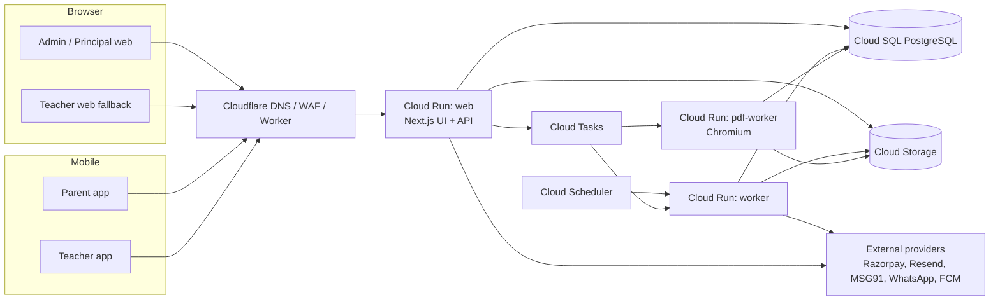
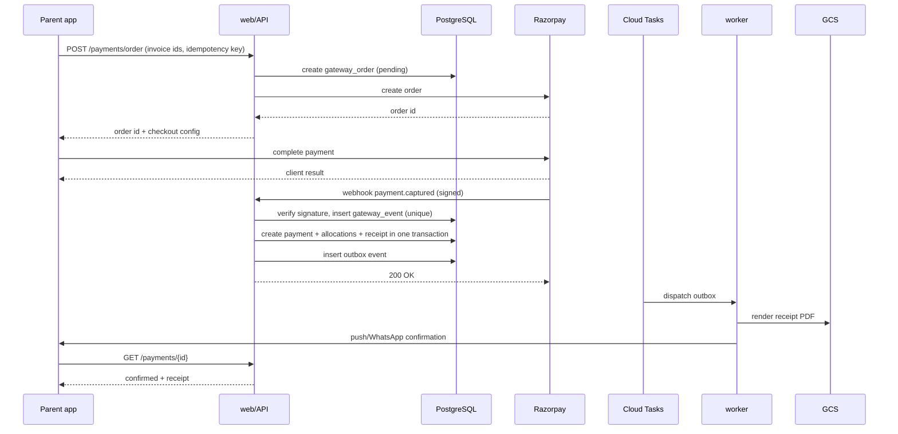

# System Architecture

**Status:** Baseline  
**Owner:** Engineering  
**Related:** [05-tech-stack.md](05-tech-stack.md), [06-aws-infrastructure.md](06-aws-infrastructure.md), [07-multi-tenancy-and-authorization.md](07-multi-tenancy-and-authorization.md), [adr/](adr/README.md)

---

## 1. Architectural Goals

1. **Correctness first.** Student, fee, exam, and payroll data must be consistent and auditable.
2. **Low operational burden.** A team of three to five engineers must be able to run production.
3. **Tenant safety.** No request, job, export, or admin action can cross schools by accident.
4. **Predictable cost.** Scale to zero where possible; pay for a warm web instance and a reliable database.
5. **Mobile-friendly.** The same backend serves web and mobile with explicit, versioned contracts.
6. **Evolvable.** Start as a modular monolith; extract services only when a measured need appears.

## 2. Architecture Style

**Modular monolith** deployed as three Container images:

| Service      | Responsibility                                                                    | Scaling            |
| ------------ | --------------------------------------------------------------------------------- | ------------------ |
| `web`        | Next.js UI and REST API routes; auth; server-rendered pages                       | Min 1 warm, max 10 |
| `worker`     | Background jobs: notifications, imports, exports, reconciliation, sync processing | Min 0, max 10      |
| `pdf-worker` | Chromium rendering for report cards, receipts, and payslips                       | Min 0, max 5       |

The codebase is a **pnpm monorepo** with strict module boundaries. Modules communicate through in-process service interfaces and domain events, not direct table access from other modules.



## 3. System Context

| Actor / system           | Interaction                                              |
| ------------------------ | -------------------------------------------------------- |
| School staff             | Web admin, teacher web, teacher app                      |
| Parents                  | Parent app, parent web fallback                          |
| Platform team            | Platform console, GCP console, observability tools       |
| Razorpay                 | Payment orders, checkout, webhooks, refunds, settlements |
| Resend                   | Transactional email                                      |
| MSG91                    | DLT-compliant SMS                                        |
| WhatsApp BSP             | Template messages and delivery webhooks                  |
| Firebase Cloud Messaging | Mobile push                                              |
| Cloudflare               | DNS, TLS, WAF, wildcard routing                          |
| Google Cloud             | Compute, database, storage, secrets, jobs, logging       |

## 4. Request Paths

### 4.1 Web page request

1. Browser resolves `{school}.erp.com` through Cloudflare.
2. Cloudflare Worker validates the host, resolves the school slug, and forwards to the Cloud Run `web` URL with `X-Tenant-Host` and `X-Origin-Secret`.
3. The app rejects requests without the correct secret when the direct Cloud Run URL is used.
4. Next.js middleware resolves the school and session.
5. Server components and route handlers call module services.
6. The database session sets `app.current_school_id`; RLS enforces isolation.
7. HTML is streamed with tenant branding; sensitive pages set `Cache-Control: no-store`.

### 4.2 API request from mobile

1. App calls `https://api.erp.com/api/v1/...` through Cloudflare.
2. Bearer access token is verified; tenant is derived from the token’s active membership and the requested resource, never from a client-supplied `school_id` alone.
3. Authorization checks role, scope, and resource ownership.
4. Response includes a request ID for support.

### 4.3 Parent payment



The client callback is advisory. Only the verified webhook or a server-side status fetch confirms payment.

### 4.4 Offline attendance sync

1. Teacher app caches today’s roster while online.
2. Offline marks are stored in SQLCipher with a client operation ID.
3. On reconnect, the app posts a batch to `/api/v1/mobile/sync/attendance`.
4. The API validates teacher assignment, date, cutoff, enrollment, and idempotency.
5. Accepted operations are written in a single transaction with an outbox event.
6. Per-operation results are returned; the client reconciles local state.
7. Conflicts are surfaced to the teacher or admin.

### 4.5 Report card generation

1. Principal publishes an exam.
2. Publish transaction validates completeness, creates result versions, and writes an outbox event.
3. Dispatcher enqueues one Cloud Task per section or a chunked batch.
4. `pdf-worker` renders HTML templates with Chromium and stores PDFs in GCS.
5. Worker updates `report_cards` with object paths and marks the job complete.
6. Push/WhatsApp notifications are queued only after all mandatory PDFs succeed.
7. Failures retry with backoff and appear in the admin exception queue.

### 4.6 Notification dispatch

1. Domain transaction inserts an outbox row.
2. Cloud Scheduler triggers the dispatcher every minute.
3. Dispatcher claims pending rows using `FOR UPDATE SKIP LOCKED`.
4. Each message becomes a Cloud Task with a stable job ID for deduplication.
5. Worker renders the template, calls the provider adapter, and records delivery status.
6. Provider webhooks update final delivery state.

## 5. Module Boundaries

```
apps/
  web/            Next.js app, route handlers, server actions
  worker/         job handlers, dispatcher, providers
  pdf-worker/     Chromium render service
packages/
  db/             schema, migrations, RLS helpers, repositories
  core/           shared domain primitives, errors, result types
  auth/           Better Auth config, session, RBAC
  modules/        platform, students, attendance, fees, exams, hr, comms, reports
  contracts/      Zod schemas, OpenAPI types, shared DTOs
  ui/             design system components
  config/         lint, tsconfig, env validation
  testing/        fixtures, factories, test helpers
mobile/
  app/            Expo app with parent and teacher variants
infra/
  terraform/      GCP and Cloudflare configuration
```

**Rules**

- A module exposes a public service interface and typed DTOs; other modules do not import its repositories or tables.
- Cross-module reads use service calls or read models, not joins on another module’s tables, except in reporting queries owned by the reports module.
- Domain events are recorded in the outbox inside the same transaction as the state change.
- Shared utilities live in `core`; business rules do not.

## 6. Runtime Components

### 6.1 Web service

- Next.js App Router, React Server Components, route handlers.
- Renders admin, principal, accountant, and parent web pages.
- Hosts the REST API under `/api/v1`.
- Handles auth callbacks, webhooks, and lightweight synchronous work.
- Enqueues anything slow: imports, exports, bulk PDFs, notifications, reconciliation.
- Health endpoints: `/healthz` (liveness), `/readyz` (database and critical dependency check).

### 6.2 Worker service

- Node process consuming Cloud Tasks HTTP requests.
- Handlers are idempotent and keyed by task name.
- Job types: outbox dispatch, email/SMS/WhatsApp/push, import commit, export generation, report-card batch orchestration, reconciliation, scheduled reminders, data retention.
- Concurrency limited by database connections and provider rate limits.

### 6.3 PDF worker

- Node HTTP service with headless Chromium.
- Accepts only signed, short-lived job payloads or Cloud Tasks OIDC-authenticated requests.
- Renders HTML/CSS templates using school branding and locale fonts.
- Stores output in GCS; never serves files directly.
- Memory 1–2 GiB, concurrency 1–2 per instance; scale to zero.

### 6.4 Database

- Cloud SQL PostgreSQL 16.
- Single zone initially; HA at 10 schools or when the SLA requires it.
- Separate databases for production and staging on the same instance.
- Connection pooling through the Cloud SQL connector and a bounded application pool.
- RLS on all tenant tables; migrations run as a separate role that bypasses RLS.

### 6.5 Object storage

| Bucket               | Contents                                  | Access                    |
| -------------------- | ----------------------------------------- | ------------------------- |
| `erp-prod-documents` | Student documents, staff documents        | Private, signed URLs      |
| `erp-prod-generated` | Receipts, payslips, report cards, exports | Private, signed URLs      |
| `erp-prod-backups`   | Logical backups and exports               | Private, retention policy |
| `erp-staging-*`      | Staging equivalents                       | Private                   |

Lifecycle rules delete temporary exports after 7 days and generated files per retention policy.

## 7. Background Jobs and the Outbox

**Why an outbox:** a database transaction cannot atomically write to Cloud Tasks. The outbox guarantees that accepted domain changes eventually produce a job.

**Outbox lifecycle**

| State        | Meaning                            |
| ------------ | ---------------------------------- |
| `pending`    | Written, not yet dispatched        |
| `dispatched` | Cloud Task created                 |
| `processing` | Worker has claimed it              |
| `completed`  | Handler succeeded                  |
| `failed`     | Retries exhausted; needs attention |
| `dead`       | Manually abandoned                 |

**Rules**

- One dispatcher per environment; use advisory locks or a lease row to avoid duplicate dispatch.
- Task names are deterministic, e.g. `invoice-{invoice_id}-issued-v1`.
- Handlers tolerate at-least-once delivery.
- Retries use exponential backoff with jitter; max attempts depend on job type.
- Permanent failures go to an exception queue visible to platform admins.
- Outbox rows are archived after 30 days.

**Queues**

| Queue            | Purpose                          | Timeout | Max attempts |
| ---------------- | -------------------------------- | ------- | ------------ |
| `notifications`  | Email, SMS, WhatsApp, push       | 60s     | 5            |
| `imports`        | Import validation/commit chunks  | 300s    | 3            |
| `exports`        | Report and data exports          | 300s    | 3            |
| `pdf`            | Report cards, receipts, payslips | 600s    | 3            |
| `reconciliation` | Gateway settlement matching      | 300s    | 5            |
| `maintenance`    | Retention, cleanup, reminders    | 600s    | 3            |

## 8. Failure Modes and Degradation

| Failure                        | Impact                     | Behavior                                                                                   |
| ------------------------------ | -------------------------- | ------------------------------------------------------------------------------------------ |
| Cloud SQL unavailable          | All writes fail            | Serve cached/read-only error pages; alert P1; no silent data loss                          |
| Cloud Run web cold/unavailable | Site down                  | Cloudflare retries; status page; min instance reduces likelihood                           |
| Cloud Tasks backlog            | Delayed notifications/PDFs | Queue depth alert; scale workers; no synchronous fallback                                  |
| Razorpay webhook delay         | Payment pending            | Parent sees pending; reconciliation job resolves; support runbook                          |
| SMS/WhatsApp provider outage   | Messages delayed           | Retry with backoff; fallback channel if configured; exception queue                        |
| Cloudflare outage              | DNS/edge down              | Direct Cloud Run URL is blocked by design; use status page and documented emergency bypass |
| PDF worker failure             | Report cards delayed       | Retry; publish status stays “generating”; admin can re-run                                 |
| Worker crash mid-job           | Job retried                | Idempotent handlers and unique constraints prevent duplicates                              |
| Redis not used                 | No cache dependency        | All critical state in Postgres/GCS; in-process cache only                                  |
| Single-zone DB failure         | Downtime until restore     | PITR, documented RTO 4h pre-HA; HA at 10 schools                                           |

**No distributed transactions.** Cross-service consistency relies on the outbox, idempotency keys, and reconciliation.

## 9. Scaling Model

**Target:** 20 schools, 20,000 students, 2,000 concurrent users.

| Dimension       | Approach                                                                                            |
| --------------- | --------------------------------------------------------------------------------------------------- |
| Web traffic     | Cloud Run horizontal scaling; 1 warm instance; concurrency 40, tuned upward only after load testing |
| Database        | Vertical first; read replicas only if measured; HA at 10 schools                                    |
| Background jobs | Queue-based; workers scale on backlog                                                               |
| PDF rendering   | Isolated service; batch sizes tuned to memory                                                       |
| Files           | GCS; signed URLs; no app-server file serving                                                        |
| Reports         | Summary tables and indexes; background exports for large ranges                                     |
| Notifications   | Provider rate limits and per-school throttles                                                       |

Bottlenecks expected in order: database connections, PDF memory, messaging provider limits, report queries. Each has an explicit mitigation.

## 10. Environments

| Environment | Purpose                 | Data                    | Isolation                                                                  |
| ----------- | ----------------------- | ----------------------- | -------------------------------------------------------------------------- |
| Local       | Development             | Synthetic               | Docker Postgres; no cloud dependency required                              |
| Staging     | Integration, UAT, demos | Synthetic or anonymized | Same GCP project; separate DB, services, queues, secrets, service accounts |
| Production  | Live schools            | Real                    | Dedicated services, database, buckets, queues, secrets                     |

Staging guardrails:

- Separate database `erp_staging` on the same Cloud SQL instance.
- Separate Cloud Run services with `-staging` suffix.
- Separate Cloud Tasks queues and scheduler jobs.
- Separate service accounts with least privilege.
- No production secrets or buckets mounted.
- Staging emails restricted to an allowlist; SMS/WhatsApp disabled or sandboxed.
- Razorpay test keys only.

## 11. Architecture Constraints

- No microservices before GA.
- No client-side authorization decisions as the security boundary.
- No cross-tenant queries without an explicit platform-admin path and audit.
- No synchronous third-party call inside a database transaction.
- No long-running work in the web request path beyond a documented limit.
- No per-school code branches.
- No direct database access from mobile apps.
- No public GCS objects.
- No card data stored or logged.

## 12. Architecture Decision Records

Significant choices are recorded in [`adr/`](adr/README.md). The baseline set covers modular monolith, shared database with RLS, Cloud Run, Cloudflare routing, Better Auth, Cloud Tasks and outbox, Expo, offline attendance, single-zone Cloud SQL, shared-project staging, Chromium PDF worker, and REST/OpenAPI.

## 13. Related Documents

- [05-tech-stack.md](05-tech-stack.md)
- [06-aws-infrastructure.md](06-aws-infrastructure.md)
- [07-multi-tenancy-and-authorization.md](07-multi-tenancy-and-authorization.md)
- [08-data-model.md](08-data-model.md)
- [09-api-contracts.md](09-api-contracts.md)
- [10-mobile-application.md](10-mobile-application.md)
- [14-observability-and-operations.md](14-observability-and-operations.md)
