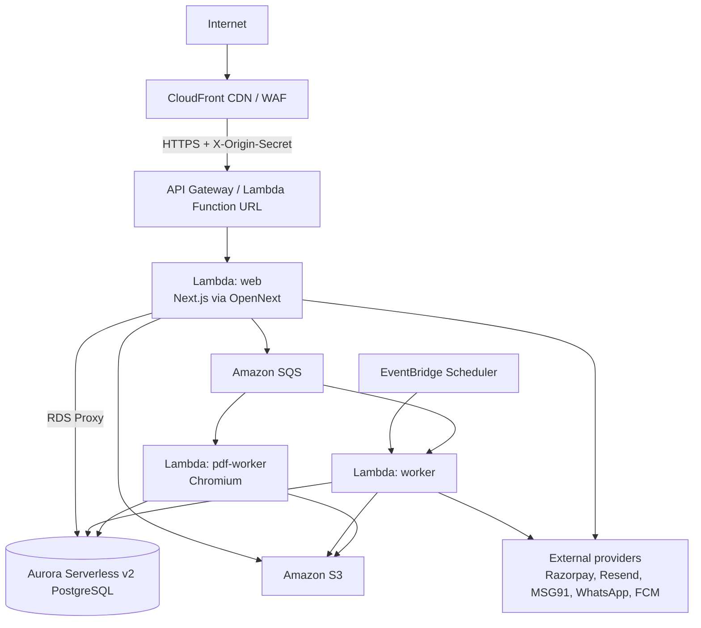

# AWS Infrastructure

**Status:** Baseline  
**Owner:** Engineering / DevOps  
**Region:** `ap-south-1` (Mumbai)  
**Related:** [04-system-architecture.md](04-system-architecture.md), [05-tech-stack.md](05-tech-stack.md), [14-observability-and-operations.md](14-observability-and-operations.md), [15-cost-model.md](15-cost-model.md)

---

## 1. Design Principles

1. **Serverless-first.** Use managed serverless services (Lambda, Aurora Serverless, SQS, S3) to minimize operational burden and cost.
2. **Auto-scaling.** Aurora Serverless v2 scales capacity automatically; Lambda scales with traffic.
3. **Private data plane.** Aurora has no public endpoint; S3 buckets are private; access via IAM and signed URLs.
4. **No Kubernetes.** Lambda and managed services remove container orchestration overhead.
5. **Connection pooling.** RDS Proxy sits between Lambda and Aurora to prevent connection exhaustion.
6. **Multi-tenant routing.** CloudFront with Lambda@Edge resolves school subdomains; origin secret protects direct Lambda access.
7. **Infrastructure as code.** All resources defined in Terraform; no manual console changes in production.

---

## 2. Region and Environments

| Item              | Value                                                                    |
| ----------------- | ------------------------------------------------------------------------ |
| Region            | `ap-south-1` (Mumbai)                                                    |
| Environments      | `prod`, `staging` in the same AWS account                                |
| Staging isolation | Separate databases, Lambda functions, SQS queues, secrets, and IAM roles |

**Why one account:** simpler billing, IAM, and networking at the current team size. Isolation is enforced by resource naming, separate databases, separate IAM roles, and tagging. A separate AWS account for staging is a post-GA option.

---

## 3. Resource Inventory

### 3.1 Compute

| Resource              | Name                 | Configuration                                      |
| --------------------- | -------------------- | -------------------------------------------------- |
| Lambda web            | `erp-web-prod`       | OpenNext; 1024 MB, 30s timeout, concurrency 1000   |
| Lambda worker         | `erp-worker-prod`    | Node.js; 512 MB, 900s timeout, SQS trigger         |
| Lambda pdf            | `erp-pdf-prod`       | Chromium layer; 2048 MB, 300s timeout, SQS trigger |
| Lambda web staging    | `erp-web-staging`    | 512 MB, 30s timeout                                |
| Lambda worker staging | `erp-worker-staging` | 512 MB, 300s timeout                               |
| Lambda pdf staging    | `erp-pdf-staging`    | 2048 MB, 300s timeout                              |

Lambda functions are deployed via OpenNext for the web app and as container images for worker/pdf.

### 3.2 Database

| Item               | Value                                                          |
| ------------------ | -------------------------------------------------------------- |
| Engine             | Aurora Serverless v2 PostgreSQL 16                             |
| Min capacity       | 0.5 ACU (scales to zero when idle)                             |
| Max capacity       | 4 ACU at launch (scales to 16+ at 20 schools)                  |
| Storage            | Auto-scaling, 10 GB minimum                                    |
| Availability       | Multi-AZ by default (Aurora)                                   |
| Backups            | Automated, 35-day retention                                    |
| PITR               | 7 days                                                         |
| Public access      | Disabled                                                       |
| Connection pooling | RDS Proxy (max 100 connections)                                |
| Databases          | `erp_prod`, `erp_staging`                                      |
| Users              | `erp_migrations`, `erp_app`, `erp_readonly`, `erp_staging_app` |

**Why Aurora Serverless v2:** auto-scales from 0.5 to 16+ ACU based on load. No manual tier changes. Multi-AZ by default. Handles 20+ schools without re-architecture.

### 3.3 Object storage

| Bucket               | Purpose                                   | Lifecycle                                                    |
| -------------------- | ----------------------------------------- | ------------------------------------------------------------ |
| `erp-prod-documents` | Student/staff documents, photos           | Retain per policy; soft-deleted objects purged after 30 days |
| `erp-prod-generated` | Receipts, payslips, report cards, exports | Retain 7 years for financial; report cards 3 years           |
| `erp-prod-exports`   | Temporary report exports                  | Delete after 7 days                                          |
| `erp-prod-backups`   | Logical backups and restore artifacts     | 90 days                                                      |
| `erp-staging-*`      | Staging equivalents                       | 7–30 days                                                    |

All buckets: block public access, server-side encryption (SSE-S3 or KMS), versioning for documents and generated files.

### 3.4 Queues and scheduling

SQS queues:

| Queue                 | Type     | Purpose                    | Timeout | Max retries |
| --------------------- | -------- | -------------------------- | ------- | ----------- |
| `notifications-prod`  | Standard | Email, SMS, WhatsApp, push | 60s     | 5           |
| `imports-prod`        | Standard | Bulk import commit         | 300s    | 3           |
| `exports-prod`        | Standard | Report export generation   | 300s    | 3           |
| `pdf-prod`            | Standard | PDF rendering jobs         | 300s    | 3           |
| `reconciliation-prod` | Standard | Payment reconciliation     | 120s    | 5           |
| `maintenance-prod`    | Standard | Data retention, cleanup    | 300s    | 3           |

Each queue has a dead-letter queue (DLQ) with 14-day retention. Failed messages after max retries go to the DLQ and trigger an alert.

EventBridge Scheduler jobs:

| Job                      | Schedule                             | Target                                      |
| ------------------------ | ------------------------------------ | ------------------------------------------- |
| `outbox-dispatch-prod`   | Every 1 minute                       | Lambda worker `/jobs/outbox/dispatch`       |
| `fee-reminders-prod`     | Daily 09:00 IST                      | Lambda worker `/jobs/reminders/fees`        |
| `attendance-alerts-prod` | Every 10 minutes during school hours | Lambda worker `/jobs/reminders/attendance`  |
| `reconciliation-prod`    | Daily 02:00 IST                      | Lambda worker `/jobs/reconciliation/run`    |
| `retention-prod`         | Weekly Sunday 03:00 IST              | Lambda worker `/jobs/maintenance/retention` |
| `usage-snapshot-prod`    | Daily 00:30 IST                      | Lambda worker `/jobs/platform/usage`        |

### 3.5 Secrets and keys

| Resource        | Name                                                                               | Notes                                             |
| --------------- | ---------------------------------------------------------------------------------- | ------------------------------------------------- |
| Secrets Manager | `database-url-prod`                                                                | Aurora connection string via RDS Proxy            |
| Secrets Manager | `better-auth-secret-prod`                                                          | Session signing                                   |
| Secrets Manager | `razorpay-key-id-prod`, `razorpay-key-secret-prod`, `razorpay-webhook-secret-prod` | Payments                                          |
| Secrets Manager | `resend-api-key-prod`                                                              | Email                                             |
| Secrets Manager | `msg91-auth-key-prod`, `msg91-sender-id-prod`                                      | SMS                                               |
| Secrets Manager | `whatsapp-token-prod`, `whatsapp-webhook-secret-prod`                              | WhatsApp BSP                                      |
| Secrets Manager | `fcm-service-account-prod`                                                         | Push                                              |
| Secrets Manager | `origin-secret-prod`                                                               | CloudFront/Lambda@Edge header                     |
| Secrets Manager | `sentry-dsn-prod`                                                                  | Error tracking                                    |
| KMS             | `erp-keyring` / `erp-data-key`                                                     | Field-level encryption for bank and statutory IDs |

Secrets are injected into Lambda as environment variables via Secrets Manager. They are never committed to the repository.

### 3.6 Observability

| Resource           | Configuration                                                                      |
| ------------------ | ---------------------------------------------------------------------------------- |
| CloudWatch Logs    | Structured JSON; 30-day retention for application logs                             |
| CloudWatch Metrics | Custom metrics for queue depth, DB connections, error rates                        |
| CloudWatch Alarms  | Error rate, latency, DB CPU/connections/storage, queue depth, DLQ messages, budget |
| X-Ray              | Distributed tracing for Lambda and API calls                                       |
| Sentry             | Web, worker, mobile crash and error tracking                                       |
| Budget             | AWS Budgets with alerts at 50%, 80%, 100%, 120%                                    |

### 3.7 Networking

- **CloudFront** provides CDN, TLS, WAF, and wildcard subdomain routing.
- **Lambda@Edge** or CloudFront Functions resolve the school subdomain and inject the origin secret.
- **RDS Proxy** pools connections between Lambda and Aurora.
- **VPC** with private subnets for Aurora and RDS Proxy; Lambda runs in VPC for DB access.
- **NAT Gateway** is avoided; use VPC endpoints for S3, SQS, Secrets Manager, and CloudWatch.

---

## 4. Compute: Lambda Deployment

### 4.1 Web (Next.js via OpenNext)

- Deployed using `@open-next/cloudfront` adapter.
- Build: `npx open-next build` produces Lambda-compatible output.
- CloudFront distribution with Lambda@Edge for routing.
- One Lambda function for SSR, one for API routes, one for image optimization.
- Concurrency: 1000 per function; CloudFront caches static assets.
- Cold start: mitigated by provisioned concurrency for the SSR function (1 warm instance).

### 4.2 Worker

- Node.js Lambda function triggered by SQS.
- Batch size: 10 messages per invocation.
- Max concurrency: 100 (configurable via reserved concurrency).
- Timeout: 900 seconds (15 minutes) for long jobs.
- Idempotent handlers; DLQ for failures.

### 4.3 PDF worker

- Lambda function with `@sparticuz/chromium` layer.
- Memory: 2048 MB; timeout: 300 seconds.
- Concurrency: 5 (Chromium is memory-intensive).
- Scale to zero when no PDF jobs.

---

## 5. Database: Aurora Serverless v2

### 5.1 Why Aurora Serverless v2

- Auto-scales from 0.5 to 16+ ACU based on CPU/memory demand.
- Multi-AZ by default; automatic failover.
- Storage auto-scales up to 128 TB.
- No manual tier changes; pay for what you use.
- PostgreSQL 16 compatible; same SQL, RLS, and extensions.

### 5.2 Capacity planning

| Schools | Students | Aurora ACU | Monthly DB cost |
| ------- | -------- | ---------- | --------------- |
| 1–5     | 5,000    | 0.5–1      | ₹4,000–8,000    |
| 5–10    | 10,000   | 1–2        | ₹8,000–16,000   |
| 10–20   | 20,000   | 2–4        | ₹16,000–32,000  |
| 20+     | 20,000+  | 4–8        | ₹32,000–64,000  |

### 5.3 Large database strategy

- **Partitioning:** `audit_logs` and `notification_deliveries` by month after 10M rows.
- **Read replicas:** Aurora read replicas for reporting queries (post-GA).
- **Connection pooling:** RDS Proxy with max 100 connections.
- **Query optimization:** `pg_stat_statements` monthly review; indexes only for measured queries.
- **Archiving:** closed academic year data to S3 Glacier; summary tables retain query access.

---

## 6. Multi-Tenant Routing

### 6.1 CloudFront + Lambda@Edge

1. School subdomain `{school}.erp.com` resolves via Route53 to CloudFront.
2. CloudFront distribution has a wildcard certificate for `*.erp.com`.
3. Lambda@Edge (viewer request) resolves the school slug from the host header.
4. Lambda@Edge injects `X-Tenant-Host` and `X-Origin-Secret` headers.
5. CloudFront forwards to the Lambda function URL.
6. The Lambda function rejects requests without the correct origin secret.

### 6.2 Why not Cloudflare

Cloudflare is replaced by CloudFront + Route53 for a fully AWS-native stack. Cloudflare's free tier was a cost optimization; at AWS scale, CloudFront provides equivalent CDN/WAF with better integration.

---

## 7. IAM and Security

### 7.1 Service roles

| Role                | Purpose             | Permissions                                                                             |
| ------------------- | ------------------- | --------------------------------------------------------------------------------------- |
| `erp-lambda-web`    | Web/API Lambda      | RDS Proxy connect, S3 read/write on app buckets, Secrets Manager read, SQS send         |
| `erp-lambda-worker` | Worker Lambda       | RDS Proxy connect, S3 read/write, Secrets Manager read, SQS receive/send, SES (if used) |
| `erp-lambda-pdf`    | PDF Lambda          | RDS Proxy connect, S3 write on generated bucket, Secrets Manager read                   |
| `erp-github-deploy` | GitHub Actions OIDC | ECR push, Lambda update, S3 deploy, CloudFront invalidation                             |
| `erp-migrations`    | Migration runner    | RDS Proxy connect (bypass RLS), schema ownership                                        |

### 7.2 Security rules

- No service account keys; use IAM roles and OIDC for GitHub Actions.
- RDS Proxy enforces IAM authentication for Lambda.
- S3 buckets block public access; use presigned URLs for downloads.
- Lambda functions run in a VPC with private subnets; no public IP.
- Use VPC endpoints for S3, SQS, Secrets Manager, and CloudWatch to avoid NAT Gateway costs.
- WAF rules on CloudFront for common attacks (SQLi, XSS, rate limiting).

---

## 8. Environments

| Resource         | Production        | Staging                                                |
| ---------------- | ----------------- | ------------------------------------------------------ |
| Lambda functions | `*-prod`          | `*-staging`                                            |
| Aurora cluster   | `erp-aurora-prod` | `erp-aurora-staging` (same cluster, separate database) |
| RDS Proxy        | `erp-proxy-prod`  | `erp-proxy-staging`                                    |
| S3 buckets       | `erp-prod-*`      | `erp-staging-*`                                        |
| SQS queues       | `*-prod`          | `*-staging`                                            |
| EventBridge      | `*-prod`          | `*-staging`                                            |
| Secrets Manager  | `*-prod`          | `*-staging`                                            |
| CloudFront       | `erp-cf-prod`     | `erp-cf-staging`                                       |

Staging shares the AWS account but has separate databases, Lambda functions, queues, secrets, and IAM roles.

---

## 9. Provisioning Checklist

1. Create the AWS account and enable billing alerts.
2. Create the VPC, private subnets, and VPC endpoints (S3, SQS, Secrets Manager, CloudWatch).
3. Create the Aurora Serverless v2 cluster and RDS Proxy.
4. Create S3 buckets with lifecycle rules and encryption.
5. Create SQS queues and DLQs.
6. Create EventBridge Scheduler jobs.
7. Create Secrets Manager secrets.
8. Create KMS key for field-level encryption.
9. Create IAM roles and policies.
10. Create Lambda functions and deploy via OpenNext/CI.
11. Create CloudFront distribution with wildcard certificate.
12. Configure Route53 DNS and wildcard routing.
13. Set up CloudWatch alarms and dashboards.
14. Configure GitHub Actions OIDC for deployment.
15. Verify Lambda direct URLs are protected.
16. Run restore drill.

---

## 10. Cost Model (AWS)

See [15-cost-model.md](15-cost-model.md) for detailed AWS pricing.

---

## 11. Related Documents

- [04-system-architecture.md](04-system-architecture.md)
- [05-tech-stack.md](05-tech-stack.md)
- [14-observability-and-operations.md](14-observability-and-operations.md)
- [15-cost-model.md](15-cost-model.md)
- [22-local-development.md](22-local-development.md)
