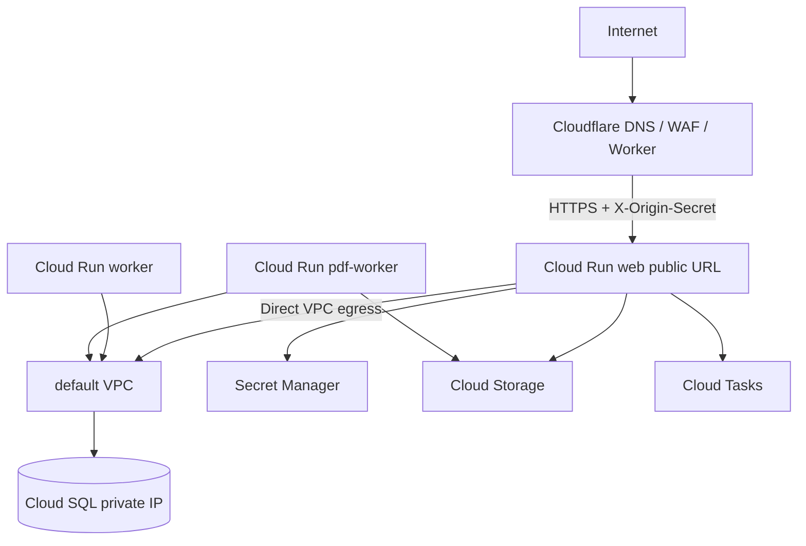

# GCP Infrastructure

**Status:** Baseline  
**Owner:** Engineering / DevOps  
**Region:** `asia-south1` (Mumbai)  
**Related:** [04-system-architecture.md](04-system-architecture.md), [13-cicd-and-release-management.md](13-cicd-and-release-management.md), [14-observability-and-operations.md](14-observability-and-operations.md), [15-cost-model.md](15-cost-model.md)

---

## 1. Infrastructure Principles

1. **One production project, two isolated environments.** Production and staging share a GCP project but not services, databases, queues, secrets, or service accounts.
2. **No Kubernetes.** Cloud Run provides managed containers and revisions.
3. **No load balancer at launch.** Cloudflare Workers route traffic to Cloud Run with an origin secret.
4. **Private data plane.** Cloud SQL has no public IP; storage buckets are private.
5. **Least privilege.** Each workload has its own service account and only the permissions it needs.
6. **Everything in Terraform.** Console changes are break-glass only and must be reconciled.
7. **Cost visibility.** Budgets, labels, and alerts are part of the baseline, not an afterthought.

## 2. Project and Region

| Item                   | Value                                   |
| ---------------------- | --------------------------------------- |
| Organization           | School ERP (single org)                 |
| Production project     | `school-erp-prod`                       |
| Region                 | `asia-south1`                           |
| Zone                   | `asia-south1-a` (single zone initially) |
| Terraform state bucket | `school-erp-tfstate`                    |
| Domain                 | TBD; examples use `erp.com`             |
| Environments           | `prod`, `staging` in the same project   |

**Why one project:** simpler IAM, billing, quotas, and networking at the current team size. Isolation is enforced by resource naming, separate databases, separate service accounts, and IAM boundaries. A separate staging project is a post-GA option.

## 3. Resource Inventory

### 3.1 Compute

| Resource                 | Name                 | Configuration                                |
| ------------------------ | -------------------- | -------------------------------------------- |
| Cloud Run web            | `erp-web-prod`       | 1 vCPU, 1 GiB, concurrency 40, min 1, max 10 |
| Cloud Run worker         | `erp-worker-prod`    | 1 vCPU, 1 GiB, concurrency 4, min 0, max 10  |
| Cloud Run pdf            | `erp-pdf-prod`       | 2 vCPU, 2 GiB, concurrency 1, min 0, max 5   |
| Cloud Run web staging    | `erp-web-staging`    | 1 vCPU, 512 MiB, min 0, max 3                |
| Cloud Run worker staging | `erp-worker-staging` | 1 vCPU, 512 MiB, min 0, max 3                |
| Cloud Run pdf staging    | `erp-pdf-staging`    | 2 vCPU, 2 GiB, min 0, max 2                  |

Request timeout: web 60s, worker 900s, pdf 900s. Startup CPU boost enabled for web. CPU allocation: always-on for web (warm instance); CPU throttled outside requests for workers is acceptable except during tasks—use CPU always allocated for worker and pdf to avoid throttling.

### 3.2 Database

| Item            | Value                                                          |
| --------------- | -------------------------------------------------------------- |
| Instance        | `erp-pg-prod`                                                  |
| Engine          | PostgreSQL 16                                                  |
| Tier            | `db-custom-1-3840` (1 vCPU, 3.75 GB)                           |
| Storage         | 50 GB SSD, auto-resize enabled                                 |
| Availability    | Zonal (single zone) initially                                  |
| Backups         | Daily automated, 30-day retention                              |
| PITR            | 7 days                                                         |
| Public IP       | Disabled                                                       |
| Private network | `default` VPC via private services access                      |
| Databases       | `erp_prod`, `erp_staging`                                      |
| Users           | `erp_app`, `erp_migrations`, `erp_readonly`, `erp_staging_app` |

Connection limits: `max_connections` tuned to 100; application pools capped at 10 per service instance; migrations use a single connection.

### 3.3 Storage

| Bucket                  | Purpose                             | Lifecycle                                                    |
| ----------------------- | ----------------------------------- | ------------------------------------------------------------ |
| `erp-prod-documents`    | Student/staff documents, photos     | Retain per policy; soft-deleted objects purged after 30 days |
| `erp-prod-generated`    | Receipts, payslips, report cards    | Retain 7 years for financial; report cards 3 years           |
| `erp-prod-exports`      | Temporary report exports            | Delete after 7 days                                          |
| `erp-prod-backups`      | Logical dumps and restore artifacts | 90 days                                                      |
| `erp-staging-documents` | Staging documents                   | 30 days                                                      |
| `erp-staging-generated` | Staging outputs                     | 7 days                                                       |
| `erp-staging-exports`   | Staging exports                     | 7 days                                                       |
| `erp-tfstate`           | Terraform state                     | Versioned                                                    |

All buckets: uniform bucket-level access, public access prevention, customer-managed encryption keys optional (Google-managed at launch), object versioning for documents and generated files.

### 3.4 Queues and Scheduler

Cloud Tasks queues:

| Queue                 | Rate limit           | Retry                       |
| --------------------- | -------------------- | --------------------------- |
| `notifications-prod`  | 50/s, 100 concurrent | Exponential, max 5 attempts |
| `imports-prod`        | 5/s                  | Max 3 attempts              |
| `exports-prod`        | 5/s                  | Max 3 attempts              |
| `pdf-prod`            | 10/s                 | Max 3 attempts              |
| `reconciliation-prod` | 1/s                  | Max 5 attempts              |
| `maintenance-prod`    | 1/s                  | Max 3 attempts              |

Each queue has a staging twin with the `-staging` suffix.

Cloud Scheduler jobs:

| Job                      | Schedule                             | Target                               |
| ------------------------ | ------------------------------------ | ------------------------------------ |
| `outbox-dispatch-prod`   | Every minute                         | worker `/jobs/outbox/dispatch`       |
| `fee-reminders-prod`     | Daily 09:00 IST                      | worker `/jobs/reminders/fees`        |
| `attendance-alerts-prod` | Every 10 minutes during school hours | worker `/jobs/reminders/attendance`  |
| `reconciliation-prod`    | Daily 02:00 IST                      | worker `/jobs/reconciliation/run`    |
| `retention-prod`         | Weekly Sunday 03:00 IST              | worker `/jobs/maintenance/retention` |
| `usage-snapshot-prod`    | Daily 00:30 IST                      | worker `/jobs/platform/usage`        |

Scheduler calls use OIDC tokens bound to a dedicated service account. Jobs must be idempotent.

### 3.5 Registry, secrets, and keys

| Resource          | Name                                                                               | Notes                                             |
| ----------------- | ---------------------------------------------------------------------------------- | ------------------------------------------------- |
| Artifact Registry | `erp-images`                                                                       | Docker, `asia-south1`                             |
| Secret Manager    | `database-url-prod`                                                                | Cloud SQL connector string                        |
| Secret Manager    | `better-auth-secret-prod`                                                          | Session signing                                   |
| Secret Manager    | `razorpay-key-id-prod`, `razorpay-key-secret-prod`, `razorpay-webhook-secret-prod` | Payments                                          |
| Secret Manager    | `resend-api-key-prod`                                                              | Email                                             |
| Secret Manager    | `msg91-auth-key-prod`, `msg91-sender-id-prod`                                      | SMS                                               |
| Secret Manager    | `whatsapp-token-prod`, `whatsapp-webhook-secret-prod`                              | WhatsApp BSP                                      |
| Secret Manager    | `fcm-service-account-prod`                                                         | Push                                              |
| Secret Manager    | `origin-secret-prod`                                                               | Cloudflare Worker header                          |
| Secret Manager    | `sentry-dsn-prod`                                                                  | Error tracking                                    |
| Cloud KMS         | `erp-keyring` / `erp-data-key`                                                     | Field-level encryption for bank and statutory IDs |

Secrets are referenced by Cloud Run as environment variables or mounted files; they are never committed to the repository.

### 3.6 Observability

| Resource         | Configuration                                                                         |
| ---------------- | ------------------------------------------------------------------------------------- |
| Cloud Logging    | Structured JSON; 30-day retention for application logs                                |
| Log sink         | Security and audit logs to `erp-prod-logs-archive` GCS, 1 year                        |
| Cloud Monitoring | Dashboards for Cloud Run, Cloud SQL, queues, scheduler, billing                       |
| Uptime checks    | `/healthz` for web and API host; 1-minute interval                                    |
| Alert policies   | Error rate, latency, DB CPU/connections/storage, queue depth, job failures, budget    |
| Sentry           | Web, worker, mobile crash and error tracking                                          |
| Budget           | ₹25,000/month budget with alerts at 50%, 80%, 100%, 120%; ₹30,000 hard review ceiling |

## 4. Networking



**Cloudflare Worker routing**

- `{school}.erp.com` → `erp-web-prod`
- `app.erp.com` → parent/teacher app landing and web fallback
- `api.erp.com` → `erp-web-prod` API
- `staging.erp.com` and `{school}.staging.erp.com` → staging web
- Worker injects `X-Tenant-Host` and `X-Origin-Secret`.
- Direct Cloud Run URLs reject requests without the secret.
- Worker strips client-supplied `X-Origin-Secret`, `X-Tenant-Host`, and forwarding headers it does not trust.
- Health checks bypass tenant routing only for `/healthz` and `/readyz`.

**Cloud Run ingress**

- `all` is required because Cloudflare Worker connects over the public internet.
- The application enforces the origin secret before any route handling.
- Cloud Armor is not used at launch; Cloudflare WAF provides edge protection.
- A future upgrade path is a global external Application Load Balancer with serverless NEG and Cloud Armor if requirements demand it.

**Database access**

- Cloud SQL private IP only.
- Cloud Run uses Direct VPC egress to the default VPC.
- No public database endpoint; no Cloud SQL Auth Proxy sidecar in production.
- Local development uses the Cloud SQL Auth Proxy only when needed; normal development uses Docker Postgres.

## 5. IAM and Service Accounts

| Service account      | Used by          | Roles                                                                                                                                                                 |
| -------------------- | ---------------- | --------------------------------------------------------------------------------------------------------------------------------------------------------------------- |
| `sa-web-prod`        | Cloud Run web    | `cloudsql.client`, `storage.objectAdmin` on app buckets, `secretmanager.secretAccessor` on app secrets, `cloudtasks.enqueuer`, `cloudkms.cryptoKeyEncrypterDecrypter` |
| `sa-worker-prod`     | Cloud Run worker | `cloudsql.client`, `storage.objectAdmin`, `secretmanager.secretAccessor`, `cloudtasks.enqueuer`, `cloudkms.cryptoKeyEncrypterDecrypter`                               |
| `sa-pdf-prod`        | Cloud Run pdf    | `cloudsql.client`, `storage.objectAdmin` on generated bucket, `secretmanager.secretAccessor` on pdf secrets                                                           |
| `sa-scheduler-prod`  | Cloud Scheduler  | `run.invoker` on worker                                                                                                                                               |
| `sa-tasks-prod`      | Cloud Tasks      | `run.invoker` on worker and pdf                                                                                                                                       |
| `sa-migrations-prod` | Migration job    | `cloudsql.client`, `secretmanager.secretAccessor`                                                                                                                     |
| `sa-deploy-prod`     | GitHub Actions   | `run.admin`, `artifactregistry.writer`, `iam.serviceAccountUser` on runtime SAs                                                                                       |
| `sa-terraform`       | Terraform        | Project-level infrastructure admin; human-approved                                                                                                                    |

Rules:

- No service account keys. Use Workload Identity Federation for GitHub Actions and OIDC for Cloud Tasks/Scheduler.
- Runtime service accounts cannot modify IAM or read unrelated secrets.
- Staging service accounts are separate and cannot read production secrets.
- Human access uses Google Groups and IAM Conditions where practical; production console access is limited to founders.
- Break-glass access is logged and reviewed.

## 6. Environment Isolation

| Resource           | Production                          | Staging                    |
| ------------------ | ----------------------------------- | -------------------------- |
| Cloud Run services | `*-prod`                            | `*-staging`                |
| Database           | `erp_prod`                          | `erp_staging`              |
| DB user            | `erp_app`                           | `erp_staging_app`          |
| Buckets            | `erp-prod-*`                        | `erp-staging-*`            |
| Queues             | `*-prod`                            | `*-staging`                |
| Secrets            | `*-prod`                            | `*-staging`                |
| Service accounts   | `sa-*-prod`                         | `sa-*-staging`             |
| Razorpay           | Live keys                           | Test keys                  |
| Email              | Live domain, school recipients only | Allowlisted addresses      |
| SMS/WhatsApp       | Live                                | Disabled or sandbox        |
| Scheduler          | Enabled                             | Enabled with harmless jobs |

**Guardrails**

- Staging app cannot read `*-prod` secrets or write to prod buckets.
- Staging database has a statement timeout and smaller connection limit.
- Staging data is synthetic or anonymized; no production PII.
- A staging deployment cannot be promoted by changing an environment variable; production deploys build a new image and revision.
- Terraform workspaces or directories separate the two environments; production apply requires manual approval.

## 7. Terraform Layout

```
infra/terraform/
  modules/
    cloud-run/
    cloud-sql/
    storage/
    tasks/
    scheduler/
    secrets/
    monitoring/
  envs/
    prod/
      main.tf
      variables.tf
      terraform.tfvars
    staging/
      main.tf
      variables.tf
      terraform.tfvars
  shared/
    project-services.tf
    artifact-registry.tf
    kms.tf
```

State is stored in GCS with versioning and locking. Plans run in CI; applies are manual for production. Drift detection runs weekly.

## 8. Provisioning Checklist

### 8.1 One-time foundation

1. Create the GCP organization and billing account; enable budget alerts.
2. Create `school-erp-prod`; enable required APIs: Run, SQL, Storage, Tasks, Scheduler, Secret Manager, KMS, Artifact Registry, Logging, Monitoring, Cloud Build (optional), IAM.
3. Create the Terraform state bucket and service account.
4. Create the VPC, private services access, and Cloud SQL instance.
5. Create Artifact Registry and the first images.
6. Create service accounts and IAM bindings.
7. Create secrets with placeholder values.
8. Create buckets and lifecycle rules.
9. Create Cloud Tasks queues and Scheduler jobs.
10. Create uptime checks, dashboards, and alert policies.
11. Configure Workload Identity Federation for GitHub Actions.
12. Configure Cloudflare DNS, Worker, and origin secret.
13. Verify Cloud Run direct URLs are rejected without the secret.
14. Run a restore drill from a PITR backup into a temporary database.

### 8.2 Per-environment

1. Apply Terraform for the environment.
2. Create the database and run migrations.
3. Deploy web, worker, and pdf images.
4. Seed reference data and a test school.
5. Verify health, auth, tenant routing, and a test payment in Razorpay test mode.
6. Enable scheduler jobs.
7. Confirm logs, metrics, and Sentry events arrive.
8. Record the deployment in the release log.

## 9. Backup and Disaster Recovery

| Item                          | Policy                                                      |
| ----------------------------- | ----------------------------------------------------------- |
| Automated backups             | Daily, 30-day retention                                     |
| PITR                          | 7 days, 15-minute RPO                                       |
| Manual pre-migration snapshot | Before every schema-changing production migration           |
| GCS versioning                | Enabled for documents and generated files                   |
| Restore drill                 | Quarterly before beta/GA, then quarterly                    |
| RTO                           | 4 hours pre-HA; 1 hour with HA target                       |
| Runbook                       | `14-observability-and-operations.md` and ops runbook folder |

**Restore procedure (summary)**

1. Declare incident and freeze deploys.
2. Identify the recovery timestamp.
3. Restore Cloud SQL to a new instance or clone.
4. Validate schema version, row counts, and a sample of financial records.
5. Repoint the application via a new secret/connection string.
6. Verify payments and outbox state; replay safe jobs.
7. Communicate to affected schools.
8. Conduct a post-incident review within five working days.

## 10. Cost Guardrails

- Budget alerts at 50%, 80%, 100%, and 120% of ₹25,000; ₹30,000 is the hard review ceiling.
- Labels: `env`, `service`, `owner`, `cost-center`.
- Cloud Run max instances capped to prevent runaway scale.
- Cloud SQL storage auto-resize capped at 200 GB until review.
- Logging excluded for health checks and static assets; 30-day retention.
- No NAT gateway; Direct VPC egress avoids connector charges.
- Artifact Registry cleanup policy keeps the last 20 images per service.
- Staging scales to zero and uses a smaller database tier where possible.
- Review billing weekly during beta and monthly after GA.

## 11. Open Infrastructure Decisions

| Decision                                                     | Owner              | Deadline |
| ------------------------------------------------------------ | ------------------ | -------- |
| Confirm domain and Cloudflare account ownership              | Founders           | Dec 2026 |
| Decide whether staging gets its own Cloud SQL instance at GA | Engineering        | Aug 2027 |
| Confirm HA trigger and budget approval                       | Founders           | Sep 2027 |
| Decide on Cloudflare paid tier trigger                       | Engineering        | Jan 2027 |
| Confirm log retention against legal advice                   | Founders / counsel | Feb 2027 |

## 12. Related Documents

- [04-system-architecture.md](04-system-architecture.md)
- [07-multi-tenancy-and-authorization.md](07-multi-tenancy-and-authorization.md)
- [11-security-and-compliance.md](11-security-and-compliance.md)
- [13-cicd-and-release-management.md](13-cicd-and-release-management.md)
- [14-observability-and-operations.md](14-observability-and-operations.md)
- [15-cost-model.md](15-cost-model.md)
