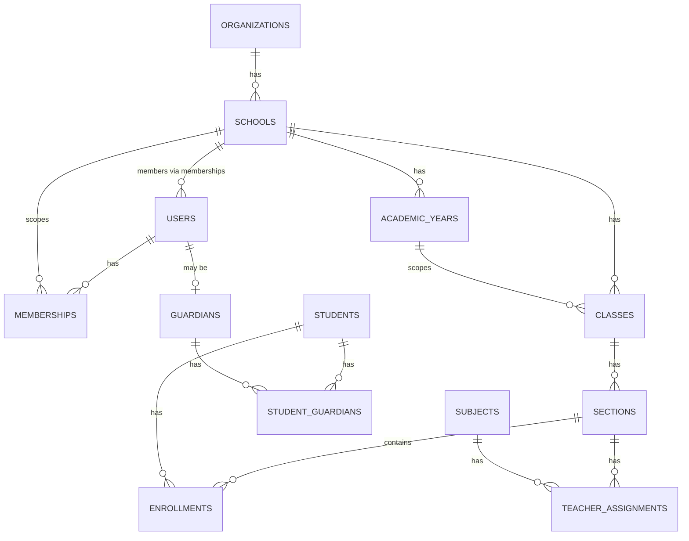

# Data Model

**Status:** Baseline  
**Owner:** Engineering  
**Related:** [07-multi-tenancy-and-authorization.md](07-multi-tenancy-and-authorization.md), [09-api-contracts.md](09-api-contracts.md), [11-security-and-compliance.md](11-security-and-compliance.md)

---

## 1. Modeling Principles

1. **The database is the source of truth.** Caches and summary tables are rebuildable.
2. **Tenant scope is explicit.** Every tenant-owned table has `school_id`.
3. **Academic year is explicit.** Enrollment, fees, attendance, exams, and timetable are year-scoped.
4. **Money is integer paise.** No floating point, no database `money` type.
5. **Time is `timestamptz`.** Store UTC; render in `Asia/Kolkata` or the school’s timezone.
6. **Financial and published records are immutable.** Corrections use new rows or versions.
7. **Constraints encode invariants.** Unique indexes, foreign keys, and checks prevent invalid states.
8. **Soft archive, not silent delete.** Financial and academic history is never hard-deleted.
9. **Audit is separate from application logs.** Business audit records live in the database.
10. **Migrations are expand/contract.** No destructive change in the same release as code that depends on it.

## 2. Conventions

| Concern            | Convention                                                               |
| ------------------ | ------------------------------------------------------------------------ |
| Primary keys       | `uuid` (UUIDv7, generated in application)                                |
| Tenant key         | `school_id uuid NOT NULL`                                                |
| Academic year      | `academic_year_id uuid NOT NULL` where year-scoped                       |
| Timestamps         | `created_at`, `updated_at timestamptz NOT NULL DEFAULT now()`            |
| Actors             | `created_by`, `updated_by uuid NULL`                                     |
| Soft delete        | `archived_at timestamptz NULL`; no hard delete for financial/academic    |
| Money              | `bigint` paise; currency fixed to INR at launch                          |
| Percentages        | `numeric(5,2)`                                                           |
| Marks              | `numeric(6,2)`                                                           |
| Status values      | `text` with named `CHECK` constraints, not native enums                  |
| Naming             | `snake_case`, plural tables                                              |
| Foreign keys       | Explicit, `ON DELETE RESTRICT` by default                                |
| Tenant FKs         | Composite `(school_id, id)` where cross-tenant references are possible   |
| Indexes            | Lead with `school_id`; add for known query paths only                    |
| Optimistic locking | `version integer NOT NULL DEFAULT 1` on mutable financial/exam records   |
| Gapless numbers    | `document_sequences` with row-level locking inside the transaction       |
| JSON               | `jsonb` for settings and provider payloads; not for core relational data |
| Search             | `pg_trgm` indexes on name and identifier columns                         |

### Identifier strategy

UUIDv7 gives time-sortable, non-guessable IDs and good index locality. Human-readable numbers (admission number, invoice number, receipt number) are separate columns with school-scoped uniqueness.

## 3. Core Entity Map

## 4. Domain Tables

### 4.1 Platform and identity

| Table                           | Purpose                    | Key columns / constraints                                                                                                                    |
| ------------------------------- | -------------------------- | -------------------------------------------------------------------------------------------------------------------------------------------- |
| `organizations`                 | Trust or group             | `name`, `billing_email`, `status`                                                                                                            |
| `schools`                       | Tenant                     | `organization_id`, `name`, `slug UNIQUE`, `board`, `timezone`, `locale`, `status`                                                            |
| `school_settings`               | Branding and configuration | `school_id`, `key`, `value jsonb`, unique `(school_id, key)`                                                                                 |
| `academic_years`                | Year                       | `school_id`, `name`, `start_date`, `end_date`, `status`; one active per school via partial unique index                                      |
| `users`                         | Global identity            | `email`, `phone`, `name`, `email_verified_at`, `phone_verified_at`, `status`                                                                 |
| `accounts`                      | Better Auth credentials    | Provider and password hash fields                                                                                                            |
| `sessions`                      | Web sessions               | `user_id`, `token_hash`, `expires_at`, `ip`, `user_agent`                                                                                    |
| `memberships`                   | Staff role in a school     | `user_id`, `school_id`, `role_id`, `status`, unique `(user_id, school_id, role_id)`                                                          |
| `roles`                         | Role definitions           | `school_id NULL` for system roles, `key`, `name`                                                                                             |
| `permissions`                   | Permission catalog         | `key UNIQUE`                                                                                                                                 |
| `role_permissions`              | Mapping                    | `role_id`, `permission_id`                                                                                                                   |
| `invitations`                   | Staff invites              | `school_id`, `email`/`phone`, `token_hash`, `expires_at`, `accepted_at`                                                                      |
| `plans` / `entitlements`        | Commercial gating          | `plan_id`, `feature_key`, limits                                                                                                             |
| `usage_records`                 | Metering                   | `school_id`, `metric`, `value`, `period`                                                                                                     |
| `impersonation_sessions`        | Support access             | `platform_user_id`, `school_id`, `reason`, `started_at`, `expires_at`, `ended_at`                                                            |
| `audit_logs`                    | Business audit             | `school_id`, `actor_id`, `action`, `entity_type`, `entity_id`, `before jsonb`, `after jsonb`, `ip`, `user_agent`, `request_id`, `created_at` |
| `outbox_events`                 | Reliable jobs              | `school_id`, `event_type`, `payload jsonb`, `status`, `attempts`, `available_at`                                                             |
| `idempotency_keys`              | API retries                | `school_id`, `key`, `request_hash`, `response jsonb`, `expires_at`                                                                           |
| `document_sequences`            | Gapless numbers            | `school_id`, `document_type`, `financial_year`, `next_value`; unique composite                                                               |
| `import_jobs` / `import_errors` | Bulk import                | `status`, `file_path`, `summary`, row-level errors                                                                                           |
| `export_jobs`                   | Background exports         | `status`, `object_path`, `expires_at`                                                                                                        |

`audit_logs` is append-only. The application role has `INSERT` and `SELECT`, no `UPDATE` or `DELETE`.

### 4.2 Students and admissions

| Table                                            | Purpose               | Key columns / constraints                                                                                                                 |
| ------------------------------------------------ | --------------------- | ----------------------------------------------------------------------------------------------------------------------------------------- |
| `students`                                       | Student identity      | `school_id`, `admission_number`, `first_name`, `last_name`, `date_of_birth`, `gender`, `status`; unique `(school_id, admission_number)`   |
| `guardians`                                      | Parent identity       | `user_id NULL`, `name`, `phone`, `email`, `occupation`; phone indexed                                                                     |
| `student_guardians`                              | Link                  | `school_id`, `student_id`, `guardian_id`, `relationship`, `is_primary`, `can_pay`, `status`; unique `(student_id, guardian_id)`           |
| `enrollments`                                    | Year enrollment       | `school_id`, `student_id`, `academic_year_id`, `class_id`, `section_id`, `roll_number`, `status`; unique `(student_id, academic_year_id)` |
| `student_documents`                              | Files                 | `school_id`, `student_id`, `document_type`, `object_path`, `verified_at`                                                                  |
| `student_consents`                               | Consent records       | `school_id`, `student_id`, `guardian_id`, `purpose`, `granted_at`, `withdrawn_at`                                                         |
| `enquiries`                                      | Admission enquiry     | `school_id`, `student_name`, `guardian_phone`, `class_sought`, `source`, `status`                                                         |
| `applications`                                   | Admission application | `school_id`, `enquiry_id`, `academic_year_id`, `status`, `converted_student_id`                                                           |
| `application_notes` / `admission_status_history` | Follow-up and audit   | `application_id`, `note`, `status`, `actor_id`                                                                                            |

### 4.3 Academics and attendance

| Table                    | Purpose                      | Key columns / constraints                                                                                                |
| ------------------------ | ---------------------------- | ------------------------------------------------------------------------------------------------------------------------ |
| `classes`                | Grade level                  | `school_id`, `academic_year_id`, `name`, `order`                                                                         |
| `sections`               | Section                      | `school_id`, `class_id`, `name`, `room`, `capacity`; unique `(class_id, name)`                                           |
| `subjects`               | Subject catalog              | `school_id`, `name`, `code`, `type`                                                                                      |
| `class_subjects`         | Subject per class            | `school_id`, `class_id`, `subject_id`, `is_mandatory`                                                                    |
| `teacher_assignments`    | Teaching scope               | `school_id`, `teacher_id`, `section_id`, `subject_id`, `academic_year_id`; unique composite                              |
| `holidays`               | Non-working days             | `school_id`, `date`, `name`, `applies_to`                                                                                |
| `periods`                | Daily periods                | `school_id`, `name`, `start_time`, `end_time`, `order`                                                                   |
| `timetable_slots`        | Weekly grid                  | `school_id`, `section_id`, `day_of_week`, `period_id`, `subject_id`, `teacher_id`, `room`, `effective_from`              |
| `attendance_sessions`    | One per section/date/session | `school_id`, `section_id`, `date`, `session_type`, `status`, `submitted_by`; unique `(section_id, date, session_type)`   |
| `attendance_records`     | Per student                  | `school_id`, `session_id`, `student_id`, `status`, `marked_by`, `marked_at`, `source`; unique `(session_id, student_id)` |
| `attendance_corrections` | Audit trail                  | `attendance_record_id`, `old_status`, `new_status`, `reason`, `actor_id`, `approved_by`                                  |
| `staff_attendance`       | Staff daily attendance       | `school_id`, `staff_id`, `date`, `status`, `source`; unique `(staff_id, date)`                                           |
| `sync_operations`        | Mobile idempotency           | `school_id`, `device_id`, `operation_id UNIQUE`, `status`, `result jsonb`                                                |

### 4.4 Fees and payments

| Table                                                               | Purpose                  | Key columns / constraints                                                                                                                                                                                           |
| ------------------------------------------------------------------- | ------------------------ | ------------------------------------------------------------------------------------------------------------------------------------------------------------------------------------------------------------------- |
| `fee_heads`                                                         | Fee categories           | `school_id`, `name`, `code`, `category`, `is_taxable`; unique `(school_id, code)`                                                                                                                                   |
| `fee_structures`                                                    | Structure per year/class | `school_id`, `academic_year_id`, `class_id`, `name`, `status`                                                                                                                                                       |
| `fee_structure_lines`                                               | Amounts                  | `school_id`, `fee_structure_id`, `fee_head_id`, `amount_paise`, `frequency`, `due_rule`                                                                                                                             |
| `fee_assignments`                                                   | Student assignment       | `school_id`, `student_id`, `fee_structure_id`, `academic_year_id`, `effective_from`                                                                                                                                 |
| `concessions`                                                       | Discounts                | `school_id`, `student_id`, `fee_head_id`, `type`, `value`, `reason`, `approved_by`, `valid_from`, `valid_to`                                                                                                        |
| `invoices`                                                          | Demand                   | `school_id`, `student_id`, `academic_year_id`, `financial_year`, `invoice_number`, `issue_date`, `due_date`, `status`, `total_paise`, `paid_paise`, `version`; unique `(school_id, financial_year, invoice_number)` |
| `invoice_lines`                                                     | Invoice detail           | `school_id`, `invoice_id`, `fee_head_id`, `amount_paise`, `concession_paise`, `net_paise`                                                                                                                           |
| `payments`                                                          | Money received           | `school_id`, `student_id`, `amount_paise`, `mode`, `status`, `gateway`, `gateway_payment_id`, `idempotency_key`, `received_at`; unique gateway payment ID                                                           |
| `payment_allocations`                                               | Invoice allocation       | `school_id`, `payment_id`, `invoice_id`, `amount_paise`; sum must equal payment amount                                                                                                                              |
| `receipts`                                                          | Receipt                  | `school_id`, `payment_id`, `receipt_number`, `financial_year`, `issued_at`, `object_path`; unique `(school_id, financial_year, receipt_number)` and `payment_id`                                                    |
| `credit_notes`                                                      | Corrections              | `school_id`, `student_id`, `amount_paise`, `reason`, `status`                                                                                                                                                       |
| `refunds`                                                           | Refunds                  | `school_id`, `payment_id`, `amount_paise`, `status`, `approved_by`, `gateway_refund_id`                                                                                                                             |
| `gateway_orders`                                                    | Payment intent           | `school_id`, `student_id`, `amount_paise`, `gateway_order_id`, `status`, `idempotency_key`                                                                                                                          |
| `gateway_events`                                                    | Webhook ledger           | `gateway`, `event_id UNIQUE`, `event_type`, `payload jsonb`, `processed_at`                                                                                                                                         |
| `settlements` / `reconciliation_runs` / `reconciliation_exceptions` | Reconciliation           | Settlement totals, matched counts, exception reasons                                                                                                                                                                |

**Financial invariants**

- `invoices.paid_paise = SUM(payment_allocations.amount_paise)` for active allocations.
- `SUM(payment_allocations) = payments.amount_paise` per payment.
- A receipt exists for every successful payment.
- Invoice and receipt numbers are gapless per school and financial year.
- Refund total ≤ unallocated payment amount.
- Cancelled invoices cannot receive allocations.

These are enforced in service transactions, with database checks and reconciliation jobs as backstops.

### 4.5 Exams

| Table                             | Purpose               | Key columns / constraints                                                                                                                                  |
| --------------------------------- | --------------------- | ---------------------------------------------------------------------------------------------------------------------------------------------------------- |
| `exam_terms`                      | Term                  | `school_id`, `academic_year_id`, `name`, `start_date`, `end_date`                                                                                          |
| `exams`                           | Exam                  | `school_id`, `term_id`, `name`, `type`, `status`                                                                                                           |
| `exam_subjects`                   | Subject configuration | `school_id`, `exam_id`, `class_id`, `subject_id`, `max_marks`, `pass_marks`, `theory_max`, `practical_max`, `weightage`                                    |
| `grading_schemes` / `grade_bands` | Grading               | `school_id`, `name`; bands with non-overlapping ranges                                                                                                     |
| `marks`                           | Student marks         | `school_id`, `exam_subject_id`, `student_id`, `theory_marks`, `practical_marks`, `status`, `entered_by`, `version`; unique `(exam_subject_id, student_id)` |
| `mark_submissions`                | Submission state      | `school_id`, `exam_subject_id`, `section_id`, `status`, `submitted_by`                                                                                     |
| `results`                         | Computed result       | `school_id`, `exam_id`, `student_id`, `total_marks`, `percentage`, `grade`, `result_status`, `version`                                                     |
| `report_card_templates`           | Template              | `school_id`, `name`, `html_template`, `version`, `is_active`                                                                                               |
| `report_cards`                    | Generated artifact    | `school_id`, `exam_id`, `student_id`, `template_version`, `object_path`, `status`, `published_at`, `version`                                               |

### 4.6 HR and payroll

| Table                            | Purpose             | Key columns / constraints                                                                                                                 |
| -------------------------------- | ------------------- | ----------------------------------------------------------------------------------------------------------------------------------------- |
| `staff`                          | Staff profile       | `school_id`, `user_id`, `employee_code`, `designation_id`, `department_id`, `joining_date`, `status`; unique `(school_id, employee_code)` |
| `staff_documents`                | Files               | `school_id`, `staff_id`, `type`, `object_path`                                                                                            |
| `leave_types` / `leave_policies` | Leave configuration | `school_id`, quota, carry-forward, paid flag                                                                                              |
| `leave_balances`                 | Balance per year    | `school_id`, `staff_id`, `leave_type_id`, `academic_year_id`, `balance`                                                                   |
| `leave_requests`                 | Requests            | `school_id`, `staff_id`, `from_date`, `to_date`, `status`, `approved_by`                                                                  |
| `salary_components`              | Earnings/deductions | `school_id`, `name`, `type`, `calculation`, `statutory`                                                                                   |
| `salary_structures`              | Staff salary        | `school_id`, `staff_id`, `effective_from`, `effective_to`, `status`                                                                       |
| `salary_structure_lines`         | Amounts             | `school_id`, `structure_id`, `component_id`, `amount_paise`, `percentage`                                                                 |
| `payroll_runs`                   | Monthly run         | `school_id`, `month`, `status`, `prepared_by`, `approved_by`, `locked_at`; unique `(school_id, month)`                                    |
| `payroll_items`                  | Per staff           | `school_id`, `run_id`, `staff_id`, gross, deductions, net, `version`; unique `(run_id, staff_id)`                                         |
| `payslips`                       | PDF artifact        | `school_id`, `payroll_item_id`, `object_path`, `issued_at`; unique `payroll_item_id`                                                      |
| `payroll_adjustments`            | Corrections/arrears | `school_id`, `staff_id`, `run_id`, `amount_paise`, `reason`                                                                               |
| `statutory_rates`                | Versioned rates     | `school_id NULL` for global, `type`, `effective_from`, `config jsonb`                                                                     |

### 4.7 Communication

| Table                                   | Purpose                | Key columns / constraints                                                          |
| --------------------------------------- | ---------------------- | ---------------------------------------------------------------------------------- |
| `notification_templates`                | Template               | `school_id`, `key`, `channel`, `language`, `body`, `status`                        |
| `template_versions`                     | Immutable versions     | `template_id`, `version`, `body`, `variables`                                      |
| `template_approvals`                    | Provider approval      | `template_id`, `provider`, `provider_template_id`, `status`                        |
| `announcements`                         | Broadcast content      | `school_id`, `title`, `body`, `audience`, `status`, `scheduled_at`, `sent_at`      |
| `announcement_audiences`                | Resolved targets       | `announcement_id`, `target_type`, `target_id`                                      |
| `notifications`                         | Logical message        | `school_id`, `event_key`, `recipient_id`, `channel`, `status`                      |
| `notification_deliveries`               | Per attempt/recipient  | `notification_id`, `provider`, `provider_message_id`, `status`, `attempt`, `error` |
| `notification_preferences` / `opt_outs` | Preferences            | `guardian_id`/`user_id`, `channel`, `category`, `status`                           |
| `provider_configs`                      | Per-environment config | `school_id NULL`, `provider`, `config` (secrets referenced, not stored)            |
| `message_costs`                         | Cost tracking          | `school_id`, `channel`, `units`, `cost_paise`, `period`                            |

### 4.8 Reporting

| Table                                                | Purpose                                        |
| ---------------------------------------------------- | ---------------------------------------------- |
| `daily_attendance_summaries`                         | Per school/section/date counts and percentages |
| `daily_fee_summaries`                                | Per school/date collection and demand          |
| `enrollment_snapshots`                               | Per school/year/class counts                   |
| `report_jobs`, `report_exports`, `scheduled_reports` | Report execution and delivery                  |

Summary tables are derived, indexed for dashboards, and rebuildable from operational data.

## 5. Key Relationships and Rules

1. `schools.slug` is globally unique and immutable after launch without a redirect plan.
2. `students` belongs to one school. A student who transfers creates a new student record at the new school, or an explicit transfer workflow post-GA.
3. `guardians` are global; `student_guardians` carries school scope.
4. `enrollments` are unique per student per academic year.
5. `attendance_sessions` are unique per section/date/session; records are unique per session/student.
6. `marks` are unique per exam subject/student.
7. `results` are unique per exam/student and versioned on re-computation.
8. `payroll_runs` are unique per school/month; `payroll_items` per run/staff.
9. A school can have only one active academic year.
10. Composite foreign keys including `school_id` prevent cross-tenant references.

## 6. Indexing Strategy

- Every tenant table: index on `(school_id, created_at)` or the primary access path.
- Student search: trigram index on `first_name`, `last_name`, and `admission_number`.
- Attendance: `(school_id, section_id, date)` and `(school_id, student_id, date)`.
- Invoices: `(school_id, student_id, status, due_date)` and `(school_id, status, due_date)`.
- Payments: `(school_id, received_at)`, `(school_id, gateway_payment_id)`.
- Marks: `(school_id, exam_subject_id)`, `(school_id, student_id)`.
- Audit: `(school_id, created_at)`, `(school_id, entity_type, entity_id)`.
- Outbox: partial index on `status = 'pending'` ordered by `available_at`.
- Avoid indexing low-cardinality status columns alone.
- Review `pg_stat_statements` monthly and add indexes only for measured queries.

## 7. Partitioning and Growth

At launch, no table partitioning except potentially `audit_logs` and `notification_deliveries` if growth warrants. Plan:

- `audit_logs`: monthly range partitions after 10 million rows.
- `notification_deliveries`: monthly partitions after 5 million rows.
- `attendance_records`: yearly partitions if a school exceeds 5 million rows.
- Archive closed academic years to cold storage while retaining query access via summary tables.

Partitioning is a post-GA optimization; the schema uses time columns that make it possible without redesign.

## 8. Migrations

**Tooling:** Drizzle Kit generates SQL; migrations are reviewed and committed. A custom runner applies them with an advisory lock and records versions in `schema_migrations`.

**Policy**

1. Expand/contract: add nullable columns or new tables, backfill, switch reads/writes, then remove old structures in a later release.
2. No destructive migration in the same deploy as the code that stops using the column.
3. Every migration is reversible or has a documented roll-forward plan.
4. Large backfills run as background jobs in batches.
5. Production migrations take a pre-migration snapshot.
6. Migrations run as `erp_migrations`, never as the runtime role.
7. Migration time budget: under 30 seconds for locks; long operations use `CONCURRENTLY` and online patterns.
8. CI runs migrations from an empty database and from a production-like snapshot.

## 9. Data Classification and Encryption

| Class        | Examples                                                      | Storage                                                                                          |
| ------------ | ------------------------------------------------------------- | ------------------------------------------------------------------------------------------------ |
| Restricted   | Bank details, statutory IDs, salary, passwords, tokens        | Encrypted at rest; field-level KMS encryption for bank/statutory IDs; masked in UI; never logged |
| Confidential | Student PII, guardian phone/email, marks, fees, medical notes | Encrypted at rest; role-scoped; audit access                                                     |
| Internal     | Staff directory, timetables, announcements                    | Encrypted at rest; staff access                                                                  |
| Public       | School name, logo, public admission form                      | Normal controls                                                                                  |

TLS 1.2+ in transit. Passwords hashed with Argon2id via Better Auth. OTPs and tokens stored hashed. Backups encrypted by Cloud SQL.

## 10. Retention and Deletion

| Data                              | Retention                          | Notes                             |
| --------------------------------- | ---------------------------------- | --------------------------------- |
| Student core record               | 7 years after last enrollment      | Archive; legal hold possible      |
| Attendance                        | 3 years                            | Summary retained longer if needed |
| Invoices, payments, receipts      | 8 years                            | Financial and tax requirements    |
| Payroll and payslips              | 8 years                            | Statutory review                  |
| Exam marks and report cards       | 5 years                            | School policy may extend          |
| Admission applications (rejected) | 1 year                             | Then purge/anonymize              |
| Documents                         | Per document type; default 7 years | Consent-based                     |
| Audit logs (business)             | 8 years                            | Append-only                       |
| Application logs                  | 30 days                            | Cloud Logging                     |
| Security/audit cloud logs         | 1 year                             | GCS sink                          |
| Backups                           | 30 days                            | PITR 7 days                       |
| Support tickets                   | 3 years                            | Post-GA system                    |
| Marketing leads                   | 1 year or consent withdrawal       | DPDP                              |

Deletion requests follow a documented workflow: verify identity, identify legal retention obligations, delete or anonymize what is permitted, record the decision, and notify the requester. Financial records are retained but access is restricted.

**These periods are planning defaults and require legal confirmation before GA.**

## 11. Seed and Reference Data

- Permissions and default roles
- Fee head categories
- Grading scheme templates
- Notification templates (English/Hindi/regional)
- Statutory rate placeholders
- Leave types
- Document types
- Country/state codes and phone prefixes
- Board names

Seed data is idempotent and versioned. School-specific data is never seeded.

## 12. Related Documents

- [07-multi-tenancy-and-authorization.md](07-multi-tenancy-and-authorization.md)
- [09-api-contracts.md](09-api-contracts.md)
- [11-security-and-compliance.md](11-security-and-compliance.md)
- [12-testing-and-quality.md](12-testing-and-quality.md)
- [20-engineering-standards.md](20-engineering-standards.md)
