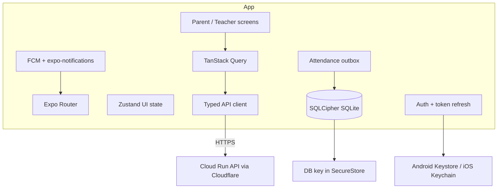

# Mobile Application

**Status:** Baseline  
**Platforms:** Android first; iOS post-GA  
**Framework:** Expo + React Native  
**Related:** [04-system-architecture.md](04-system-architecture.md), [09-api-contracts.md](09-api-contracts.md), [modules/parent-app.md](modules/parent-app.md), [modules/teacher-app.md](modules/teacher-app.md)

---

## 1. Product Shape

One Expo/React Native codebase produces two Android applications:

| App                | Package ID              | Primary users             |
| ------------------ | ----------------------- | ------------------------- |
| School ERP Parent  | `com.schoolerp.parent`  | Guardians                 |
| School ERP Teacher | `com.schoolerp.teacher` | Teachers and school staff |

Both apps share authentication, API client, design system, localization, analytics, and offline infrastructure. Variant-specific code is limited to navigation, feature surfaces, and permissions.

**Why two apps instead of one:** app store clarity, smaller installs, role-appropriate permissions, and simpler privacy disclosures. Parents should not see teacher tools, and teachers should not see fee-payment surfaces.

## 2. Architecture



### 2.1 Libraries

| Concern           | Choice                                                    |
| ----------------- | --------------------------------------------------------- |
| Runtime           | Expo SDK current at kickoff                               |
| Navigation        | Expo Router                                               |
| Server state      | TanStack Query                                            |
| Local UI state    | Zustand                                                   |
| Validation        | Zod schemas from `packages/contracts`                     |
| Secure storage    | Expo SecureStore                                          |
| Local database    | SQLite + SQLCipher via config plugin/custom dev client    |
| Network awareness | `@react-native-community/netinfo`                         |
| Push              | `expo-notifications` + FCM                                |
| Payments          | Razorpay React Native SDK; browser fallback               |
| PDFs              | Download + OS share/open; no in-app PDF renderer required |
| Localization      | i18next + react-i18next                                   |
| Errors            | Sentry React Native                                       |
| Analytics         | Privacy-conscious in-house events; no third-party ad SDKs |
| E2E               | Maestro                                                   |

### 2.2 Repository layout

```
mobile/
  app/                 Expo Router routes
  src/
    features/parent/
    features/teacher/
    features/auth/
    features/attendance/
    features/fees/
    features/results/
    components/
    lib/api/
    lib/auth/
    lib/db/
    lib/sync/
    lib/i18n/
    lib/notifications/
  assets/
  app.config.ts
  eas.json (optional)
  package.json
```

Variant selection uses `APP_VARIANT=parent|teacher` at build time. The config sets app name, package ID, scheme, icon, splash, and allowed features. Server-side authorization remains the security boundary; hiding a screen is not a control.

## 3. Authentication and Session

### 3.1 Parent

1. Enter phone number.
2. Server sends OTP via SMS.
3. Verify OTP; server returns access JWT and refresh token.
4. Tokens stored in SecureStore.
5. App registers the device and FCM token.
6. Guardian link determines visible children.

### 3.2 Teacher

- Phone OTP by default, or school-issued email/password if configured.
- Optional 4-digit app PIN or biometric unlock after first login.
- Same token model as parents.
- Role and assignments fetched after login.

### 3.3 Token handling

- Access token: 15 minutes.
- Refresh token: 30 days, rotating.
- One refresh at a time; concurrent 401s wait for the same refresh promise.
- Refresh reuse revokes the token family and forces login.
- Logout calls the server, clears SecureStore, deletes the local database and key, and unregisters the FCM token.
- App resume after 7 days requires re-authentication for teacher accounts.

## 4. Offline Attendance

Offline attendance is the only offline write capability. Fees, marks, payroll, and profile changes require connectivity.

### 4.1 Local schema

| Table                  | Purpose                        |
| ---------------------- | ------------------------------ |
| `cached_sections`      | Assigned sections and metadata |
| `cached_students`      | Roster with minimal PII        |
| `attendance_drafts`    | Current marks per student      |
| `outbox_operations`    | Pending sync operations        |
| `sync_state`           | Last sync, cursor, errors      |
| `cached_announcements` | Read-only announcements        |
| `cached_profile`       | Own profile and child summary  |

The database is encrypted with SQLCipher. The key is generated on first launch, stored in SecureStore, and never written to logs or backups. On logout or remote revocation, the database file and key are deleted.

### 4.2 Prefetch

- On login and app foreground, fetch today’s classes and rosters.
- Roster cache is valid for the school day; stale data is labeled.
- If the app has never synced a roster, offline attendance is disabled with a clear message.
- The cache includes only assigned sections and active students.

### 4.3 Marking flow

1. Teacher selects a class.
2. App loads cached roster and any existing draft.
3. Default all present; teacher toggles absentees.
4. Save writes to `attendance_drafts` and an `outbox_operations` row.
5. If online, sync starts immediately; if offline, status shows pending.
6. UI never shows “submitted” until the server returns `applied` or `duplicate`.

### 4.4 Sync

- Triggered on app foreground, network regain, manual retry, and after save when online.
- Batches up to 10 operations or 500 records.
- Exponential backoff with jitter; max 5 automatic attempts, then manual retry.
- Each operation carries a client UUID; the server enforces uniqueness.
- Per-operation results update local state.
- Conflicts show the server value, local value, and resolution choice.
- Successfully synced drafts are purged after the server acknowledgment, retaining a short local audit window.

### 4.5 Conflict policy

| Scenario                                            | Resolution                                                          |
| --------------------------------------------------- | ------------------------------------------------------------------- |
| Same teacher, same session, server already has data | Last write wins if server session is still open; otherwise conflict |
| Admin corrected attendance                          | Conflict shown; teacher cannot overwrite silently                   |
| Student transferred                                 | Server rejects the record; roster refreshes                         |
| Holiday declared                                    | Server rejects; app shows holiday message                           |
| Duplicate operation                                 | Server returns `duplicate`; app marks synced                        |

### 4.6 Cutoffs and time

- Server clock is authoritative.
- Offline marking is allowed for today and yesterday only.
- After the school cutoff, new offline submissions are rejected; the app warns before marking.
- Device time changes do not bypass validation.

## 5. Parent App Surfaces

| Tab        | Contents                                                               |
| ---------- | ---------------------------------------------------------------------- |
| Home       | Child switcher, today’s attendance, dues summary, latest announcements |
| Attendance | Calendar, monthly percentage, absence details                          |
| Fees       | Invoices, pay, history, receipts                                       |
| Results    | Published exams, marks, report-card download (GA)                      |
| More       | Profile, children, preferences, language, support, privacy             |

Key flows:

- **Pay fees:** select invoices → review amount → Razorpay checkout → pending → server confirmation → receipt.
- **Receipt:** download PDF, share via OS sheet, or view payment detail.
- **Results:** available only after publish; report-card PDF is downloaded on demand.
- **Announcements:** in-app inbox; push opens the detail.
- **Profile correction:** request change; school approves sensitive fields.

## 6. Teacher App Surfaces

| Tab     | Contents                                            |
| ------- | --------------------------------------------------- |
| Today   | Timetable classes, attendance status, quick actions |
| Classes | Assigned sections, roster, history                  |
| Marks   | Exam-subject assignments, entry, submission (GA)    |
| Me      | Profile, leave, payslips, devices, support          |

Key flows:

- **Attendance:** today’s class → roster → mark → save → sync status.
- **Marks:** exam → subject → section → enter → save draft → submit.
- **Leave:** balance → request → status.
- **Payslip:** list → download → OS share.

## 7. Push Notifications

- FCM via `expo-notifications`.
- Android notification channels: `attendance`, `fees`, `results`, `announcements`, `default`.
- Permission requested contextually after the first useful action, not at first launch.
- Token registered with the server per device; removed on logout.
- Invalid tokens are pruned after provider errors.
- Deep links use the app scheme and universal/app links where configured.
- Notification payloads contain IDs and short text, never marks, amounts, or full PII.
- Quiet hours are enforced server-side for non-urgent messages.
- Parents can manage non-essential categories in settings.

## 8. Payments

- Server creates the Razorpay order; the app never calculates the amount.
- Razorpay React Native SDK opens checkout.
- The app handles success, failure, and cancellation callbacks as hints only.
- The server webhook is authoritative; the app polls or refreshes payment status.
- If the SDK is unavailable in a build, fall back to a secure browser checkout.
- No card data touches the app or servers.
- Receipts are downloaded from authenticated, short-lived URLs.
- Refunds are initiated by the school, not the app.

## 9. Localization and Accessibility

- Languages: English, Hindi, and one regional language at launch.
- All strings externalized; no concatenated sentences.
- Devanagari and regional fonts bundled; test on low-end devices.
- Dates: `DD/MM/YYYY`; numbers: Indian grouping; currency: `₹`.
- Font scaling supported up to 200% without clipping critical actions.
- Minimum touch target 44×44 dp.
- Screen-reader labels for icons, inputs, and status chips.
- Color is never the only indicator of attendance or payment status.
- Error messages are plain language and actionable.

## 10. Security

| Control             | Implementation                                                         |
| ------------------- | ---------------------------------------------------------------------- |
| Transport           | TLS 1.2+; cleartext disabled in Android network security config        |
| Tokens              | SecureStore; never in AsyncStorage or logs                             |
| Local DB            | SQLCipher; key in SecureStore; deleted on logout                       |
| Screenshots         | Allowed; no sensitive data beyond what the user can already see        |
| Root detection      | Not a hard block; optional risk signal post-GA                         |
| Certificate pinning | Not at launch; evaluate post-GA with a rotation plan                   |
| Clipboard           | No automatic copying of tokens or full bank data                       |
| Logs                | No PII, tokens, OTPs, or payment payloads                              |
| Deep links          | Validated; authenticated routes require a session                      |
| Jailbreak/emulator  | Allowed for support; sensitive actions still server-authorized         |
| App background      | Sensitive screens obscured in the task switcher (optional, parent app) |
| Remote revocation   | Server-side session and device revocation enforced on next request     |

## 11. Build and Release

**Toolchain:** Expo prebuild + local Gradle + GitHub Actions. EAS Build is optional for convenience but not required.

### 11.1 Android

1. `expo prebuild` generates the native project.
2. CI builds a signed AAB with a keystore stored in GitHub Secrets.
3. Version code is monotonic; version name follows semver.
4. Artifact is uploaded to GitHub Actions and manually uploaded to Play Console.
5. Internal testing → closed testing with pilot schools → production.

### 11.2 Signing

- Upload keystore generated once and backed up securely offline.
- Play App Signing enabled.
- Keystore passwords in GitHub Secrets and a sealed offline record.
- No debug keys in release builds.

### 11.3 iOS (post-GA)

- Requires a macOS runner or local Mac.
- Apple Developer account, certificates, provisioning profiles.
- TestFlight before App Store release.

### 11.4 Updates

- Store releases are the primary channel.
- No OTA JavaScript updates at launch.
- Evaluate Expo Updates post-GA for JS-only hotfixes with code signing and store-policy review.
- Minimum supported version enforced by the API; below-minimum users see a blocking upgrade screen.

## 12. Store Readiness

- Privacy policy and terms.
- Data safety form (Android) and privacy nutrition labels (iOS later).
- Account deletion path.
- Content rating.
- Target API level compliance.
- App access instructions for reviewers, including test credentials.
- Screenshots and store listing in English and Hindi.
- Support email and URL.
- Permission rationale for notifications, camera (document upload if added), and phone (OTP autofill).
- No unnecessary permissions.

## 13. Testing

| Layer          | Tool                                | Scope                                                                |
| -------------- | ----------------------------------- | -------------------------------------------------------------------- |
| Unit           | Vitest                              | Sync logic, validators, formatters                                   |
| Component      | React Native Testing Library        | Screens, states, accessibility                                       |
| E2E            | Maestro                             | Login, attendance offline, payment, results                          |
| Contract       | Generated types + mocked API        | Schema compatibility                                                 |
| Device matrix  | Manual + Firebase Test Lab optional | Android 9, 12, 14; low RAM; tablet                                   |
| Offline matrix | Manual/automated                    | Airplane mode, drop mid-sync, duplicate sync, clock change, conflict |
| Performance    | Manual                              | Cold start under 3s on mid-range; roster under 1s                    |

Release gates:

- No P0/P1 defects.
- Crash-free sessions above 99.5% in closed testing.
- Offline attendance passes the full matrix.
- Payment flow verified in Razorpay test mode and a small live test.
- Accessibility spot check passed.
- Store listing and privacy forms complete.

## 14. Observability

- Sentry for crashes, ANRs, and handled errors with release tags.
- Structured client logs with no PII, sampled.
- Key analytics events: login, child switch, attendance submit, sync result, payment start/success/failure, result view, notification open.
- Crash-free rate, sync success rate, payment funnel, and app version distribution dashboards.
- Alerts for a crash-free rate drop after a release.

## 15. Release Process

1. Freeze features for the release branch.
2. Run CI, unit, component, and Maestro suites.
3. Build signed AAB with an incremented version.
4. Internal test on physical devices.
5. Closed testing with 5–10 staff/parents for 3–5 days.
6. Review crash and sync metrics.
7. Promote to production with staged rollout (10% → 50% → 100%).
8. Monitor for 48 hours; halt rollout on regression.
9. Tag the release and update the changelog.

## 16. Related Documents

- [09-api-contracts.md](09-api-contracts.md)
- [11-security-and-compliance.md](11-security-and-compliance.md)
- [12-testing-and-quality.md](12-testing-and-quality.md)
- [13-cicd-and-release-management.md](13-cicd-and-release-management.md)
- [modules/parent-app.md](modules/parent-app.md)
- [modules/teacher-app.md](modules/teacher-app.md)
- [adr/0007-expo-single-codebase.md](adr/0007-expo-single-codebase.md)
- [adr/0008-offline-attendance-only.md](adr/0008-offline-attendance-only.md)
