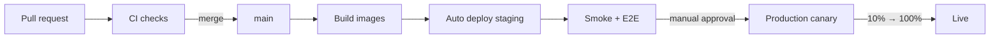

# CI/CD and Release Management

**Status:** Baseline  
**Owner:** Engineering  
**Related:** [06-gcp-infrastructure.md](06-gcp-infrastructure.md), [10-mobile-application.md](10-mobile-application.md), [12-testing-and-quality.md](12-testing-and-quality.md), [14-observability-and-operations.md](14-observability-and-operations.md)

---

## 1. Principles

1. **Trunk-based development.** `main` is always deployable.
2. **Small, frequent changes.** Short-lived branches, reviewed and merged within two days.
3. **Everything automated.** Build, test, scan, migrate, deploy, verify.
4. **No long-lived cloud keys.** GitHub Actions uses Workload Identity Federation.
5. **Same artifact everywhere.** Build once; promote the same image by digest.
6. **Migrations are separate and reversible.** Application rollout and schema rollout are coordinated.
7. **Production is deliberate.** Manual approval, canary, verification, and rollback.
8. **Mobile releases are store-gated.** Internal → closed → production with staged rollout.

## 2. Branching and Commits

| Item             | Convention                                                              |
| ---------------- | ----------------------------------------------------------------------- |
| Main branch      | `main`, protected                                                       |
| Feature branches | `feat/short-description`, `fix/...`, `chore/...`                        |
| Lifetime         | Target under 2 days; rebase on main                                     |
| Merge            | Squash merge                                                            |
| Commits          | Conventional Commits (`feat(fees): ...`)                                |
| Review           | At least one approval; two for security, payments, payroll, auth, infra |
| Required checks  | Type check, lint, unit, integration, contract, secret scan, build       |
| Force push       | Allowed on feature branches only                                        |
| Release tags     | `v1.0.0-beta.1`, `v1.0.0`, etc.                                         |

## 3. Environments and Promotion



| Stage             | Trigger                               | Approval         |
| ----------------- | ------------------------------------- | ---------------- |
| PR checks         | Every push                            | None             |
| Staging deploy    | Merge to `main`                       | None             |
| Production deploy | Manual workflow on a tagged commit    | Engineering lead |
| Migration         | Part of production deploy             | Engineering lead |
| Mobile production | Manual workflow + Play Console review | Product + QA     |
| Terraform apply   | PR plan; manual production apply      | Engineering lead |

## 4. GitHub Actions Workflows

| Workflow          | File                                   | Purpose                                                        |
| ----------------- | -------------------------------------- | -------------------------------------------------------------- |
| CI                | `.github/workflows/ci.yml`             | Type check, lint, unit, integration, contract, security, build |
| Deploy staging    | `.github/workflows/deploy-staging.yml` | Build, push, migrate, deploy, smoke                            |
| Deploy production | `.github/workflows/deploy-prod.yml`    | Promote image, migrate, canary, verify                         |
| Android           | `.github/workflows/android.yml`        | Signed AAB build and artifact                                  |
| Terraform         | `.github/workflows/terraform.yml`      | Plan on PR, apply on approval                                  |
| Nightly           | `.github/workflows/nightly.yml`        | Full E2E, Maestro, DAST baseline, dependency audit             |
| Rollback          | `.github/workflows/rollback.yml`       | Re-route traffic to a prior revision                           |

### 4.1 CI steps

1. Checkout with full history for affected-project detection.
2. Setup Node from `.nvmrc`, restore pnpm cache.
3. Install with `--frozen-lockfile`.
4. Type check and lint.
5. Unit tests with coverage.
6. Start ephemeral Postgres; run migrations; integration tests.
7. Generate OpenAPI and verify no drift.
8. Secret scan, dependency audit, SAST.
9. Build Docker images for web, worker, pdf.
10. Trivy scan; fail on critical fixable vulnerabilities.
11. Upload artifacts and test reports.
12. On `main`, push images to Artifact Registry tagged with commit SHA and digest.

### 4.2 OIDC to GCP

```yaml
permissions:
  contents: read
  id-token: write
```

- GitHub OIDC provider configured in GCP.
- `sa-deploy-prod` impersonation restricted to the repository and branch.
- No JSON keys in GitHub Secrets.
- Artifact Registry push uses the short-lived token.

## 5. Container Build

- Multi-stage Dockerfile: dependencies → build → runtime.
- Runtime image: Node slim or distroless, non-root user, read-only filesystem, no shell where possible.
- `NEXT_TELEMETRY_DISABLED=1`.
- Only production dependencies in the final image.
- PDF image includes Chromium and required fonts (Noto Sans, Noto Sans Devanagari, regional font).
- Health check endpoints.
- Image labels: source, commit, version, build time.
- SBOM generated and attached to the image where tooling permits.
- Image digest recorded in the release log.

## 6. Database Migrations

**Runner:** a dedicated Cloud Run job `erp-migrate-prod` using the migration image and `erp_migrations` role.

**Rules**

1. Migrations are SQL files committed to the repo and reviewed.
2. The runner acquires a Postgres advisory lock.
3. Each migration runs once and is recorded in `schema_migrations`.
4. Failed migrations stop the deploy; no partial release.
5. Expand/contract only; destructive changes are separate releases.
6. Long backfills run as background jobs after the schema change.
7. A pre-migration snapshot is taken for production.
8. Migration output is logged without secrets.

**Deploy order**

1. Back up/snapshot.
2. Run expand migration (backward compatible).
3. Deploy new web/worker revisions.
4. Verify.
5. Run contract migration in a later release after old code is gone.

**Rollback:** application rollback is always possible. Schema rollback is avoided; use forward fixes.

## 7. Production Deployment

### 7.1 Pre-deploy checklist

- [ ] Release tagged and changelog updated.
- [ ] CI green on the commit.
- [ ] Staging verified for at least 24 hours.
- [ ] Migrations reviewed and snapshot taken.
- [ ] Feature flags default off for risky features.
- [ ] Rollback revision identified.
- [ ] On-call aware.
- [ ] No active P1 incident.
- [ ] Not within a school freeze window (exams, results, fee due dates, payroll).

### 7.2 Deploy steps

1. Promote the exact staging image digest to production.
2. Run the migration job; wait for success.
3. Deploy the new Cloud Run revision with no traffic.
4. Run smoke tests against the revision URL with the origin secret.
5. Shift 10% traffic; monitor error rate, latency, and logs for 15 minutes.
6. Shift 100% if healthy.
7. Run post-deploy verification: login, tenant routing, attendance read, fee read, payment test-mode check, job processing.
8. Announce completion in the release channel.

### 7.3 Canary signals

| Signal                 | Threshold                      |
| ---------------------- | ------------------------------ |
| 5xx rate               | < 0.5% and not double baseline |
| p95 latency            | < 1.5× baseline                |
| Worker failures        | < 2%                           |
| Payment webhook errors | 0                              |
| Auth failures          | Not above baseline             |
| Sentry new issues      | No new high-volume issue       |

### 7.4 Rollback

**Application:**

1. Route 100% traffic to the previous revision.
2. Confirm health and error rate.
3. Disable any feature flag introduced by the release.
4. Keep the database migration in place if backward compatible.
5. Open an incident and root-cause review.

**Database:** forward fix preferred. Restore from snapshot only for corruption, with incident commander approval.

**Mobile:** halt staged rollout in Play Console; ship a hotfix with an incremented version.

## 8. Feature Flags

- Database-backed flags with environment and school targeting.
- Flags have an owner, description, default, and expiry date.
- Use for risky changes, gradual rollout, and kill switches.
- Do not use flags as a substitute for access control.
- Remove flags within 60 days after full rollout.
- Critical kill switches: payments, WhatsApp, SMS, PDF generation, new report-card template.

## 9. Versioning and Release Notes

- Semantic versioning for the platform: `MAJOR.MINOR.PATCH`.
- Pre-release labels: `-beta.1`, `-rc.1`.
- Container tags: `sha-<short>`, `v1.2.3`, `staging`, `prod`.
- Changelog generated from Conventional Commits and reviewed.
- Release notes group changes by module and note migrations, flags, and known issues.
- Each release records: version, commit, image digests, migration versions, deployer, timestamps, rollback revision.

## 10. Mobile Releases

See [10-mobile-application.md](10-mobile-application.md) for build details.

| Step                                             | Owner       |
| ------------------------------------------------ | ----------- |
| Feature freeze                                   | Product     |
| CI + Maestro                                     | QA          |
| Signed AAB                                       | Engineering |
| Internal testing                                 | QA          |
| Closed testing with pilot users                  | Product/QA  |
| Play Console production rollout 10% → 50% → 100% | Product     |
| Post-release monitoring 48h                      | Engineering |

Version code increments on every upload. Never reuse a version code. Minimum supported version is controlled server-side.

## 11. Infrastructure Changes

- Terraform changes go through PR with `terraform plan`.
- Production apply requires approval and is logged.
- State is locked and versioned.
- Destructive changes (bucket deletion, database replacement) require a written plan and backup.
- Drift detection runs weekly; manual console changes are reconciled or reverted.

## 12. Secrets and Configuration

- Secrets in Secret Manager, referenced by Cloud Run.
- Non-secret configuration in environment variables validated at startup.
- `.env.example` documents required variables.
- No secrets in Git, Docker images, logs, or error reports.
- Rotation procedure documented for each secret.
- Staging and production use separate secrets.

## 13. Freeze Windows

No production deploys during:

- Pilot school admissions week
- Fee due dates and the following two days
- Exam weeks and result publication
- Payroll processing and salary credit dates
- Major school events communicated in advance

Emergency security fixes are exempt with incident commander approval.

## 14. Hotfix Process

1. Create a branch from the production tag.
2. Implement the minimal fix with a test.
3. Obtain two approvals for security, payments, or auth.
4. Run CI and a focused regression suite.
5. Deploy through the normal production workflow with canary.
6. Cherry-pick to `main`.
7. Document the incident and follow-up.

## 15. Release Cadence

| Period        | Cadence                                         |
| ------------- | ----------------------------------------------- |
| Alpha         | Weekly                                          |
| Beta          | Weekly or biweekly, school-informed             |
| GA            | Biweekly                                        |
| Stabilization | Weekly fixes, no new scope                      |
| Post-GA       | Every two weeks, with monthly platform releases |

## 16. Related Documents

- [06-gcp-infrastructure.md](06-gcp-infrastructure.md)
- [10-mobile-application.md](10-mobile-application.md)
- [12-testing-and-quality.md](12-testing-and-quality.md)
- [14-observability-and-operations.md](14-observability-and-operations.md)
- [20-engineering-standards.md](20-engineering-standards.md)
