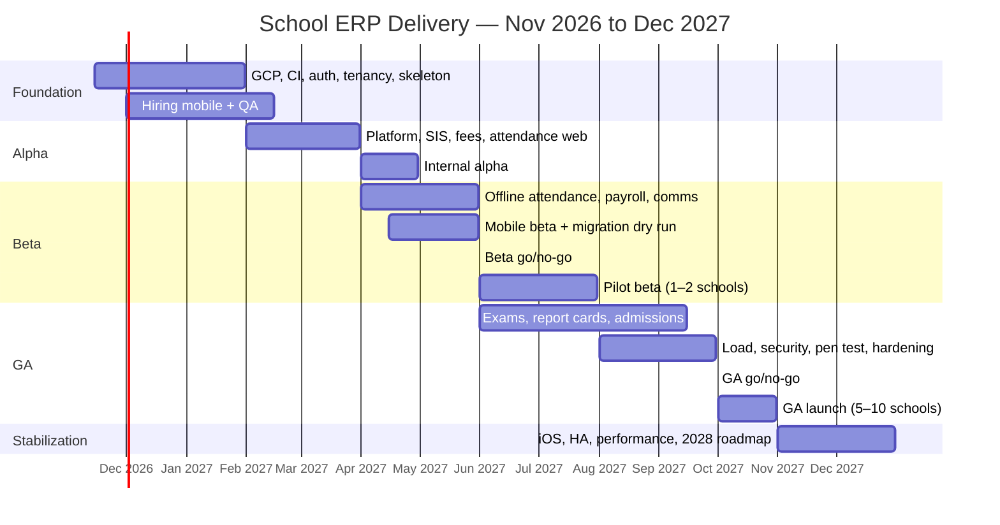

# Delivery Roadmap

**Status:** Baseline  
**Owner:** Founders  
**Timeline:** November 2026 – December 2027  
**Beta:** June 2027  
**GA:** October 2027  
**Related:** [01-product-vision-and-scope.md](01-product-vision-and-scope.md), [17-team-and-hiring-plan.md](17-team-and-hiring-plan.md), [18-pilot-onboarding-and-migration.md](18-pilot-onboarding-and-migration.md), [19-risk-register.md](19-risk-register.md)

---

## 1. Delivery Strategy

The academic calendar dictates the plan. Indian schools need admissions, fees, and attendance before the new session, and report cards after exams. The roadmap therefore delivers a **working operational core** first, then the **academic and admissions layer**, then hardening.

**Principles**

- Build a vertical slice end to end before broadening.
- Keep beta scope narrow and reliable.
- Freeze scope at each gate.
- Move dates rather than compress QA, security, or migration.
- Onboard pilot schools early enough to influence configuration, not code forks.
- Do not start a module without a named owner, acceptance criteria, and test plan.

## 2. Timeline at a Glance

## 3. Phases

### Phase 0 — Foundation (November 2026 – January 2027)

**Goal:** A deployable skeleton with tenancy, authentication, CI/CD, and infrastructure proven end to end.

| Workstream     | Deliverables                                                                       |
| -------------- | ---------------------------------------------------------------------------------- |
| Product        | Final beta/GA scope, module specs, acceptance criteria, design system foundations  |
| Infrastructure | GCP project, Cloud SQL, Cloud Run, Cloudflare routing, secrets, Terraform, budgets |
| Platform       | Repo, monorepo, CI, staging deploy, migrations, logging, error tracking            |
| Auth           | Better Auth, staff login, invitations, sessions, TOTP, mobile OTP skeleton         |
| Tenancy        | `school_id`, RLS, tenant resolution, isolation test harness                        |
| Design         | Component library, admin shell, mobile navigation shell, brand tokens              |
| Hiring         | Mobile engineer and QA engineer offers accepted; onboarding plan ready             |
| Vendors        | Razorpay KYC, Resend domain, MSG91 DLT, WhatsApp BSP, Play Console account         |
| Pilots         | LOIs signed, discovery workshops scheduled, data templates shared                  |

**Exit criteria**

- A test school can be created and accessed at its subdomain.
- Staff can sign in with MFA; parent OTP works in staging.
- RLS blocks cross-tenant access in automated tests.
- `main` deploys to staging automatically; production deploy is rehearsed.
- Backups and a restore drill succeed.
- Budget alerts and uptime checks are live.

### Phase 1 — Operational Core (February – March 2027)

**Goal:** Platform, students, fees, and attendance work end to end on the web. Internal alpha by end April.

| Workstream | Deliverables                                                                                              |
| ---------- | --------------------------------------------------------------------------------------------------------- |
| Platform   | Organization/school setup, academic year, classes/sections/subjects, staff invites, imports, audit        |
| SIS        | Student/guardian records, enrollment, documents, search, export                                           |
| Fees       | Fee heads, structures, invoices, offline payments, Razorpay integration, receipts, dues, daily collection |
| Attendance | Daily attendance, holidays, registers, admin corrections, absence alerts (queued)                         |
| Web        | Admin shell, dashboards, role-based navigation, error/empty states                                        |
| Mobile     | Login, child dashboard, attendance view; teacher roster and online attendance                             |
| QA         | Tenant isolation suite, financial invariants, core E2E, import tests                                      |
| Ops        | Runbooks, on-call rotation, staging UAT environment                                                       |

**Gate — 31 March 2027**

- Foundation, SIS, fees, and attendance working end to end.
- Tenant isolation and financial invariant suites green.
- A school can be configured and imported without engineering help.
- A parent can view attendance and pay a test invoice.
- Internal alpha scope signed off.

If this gate slips by more than two weeks, move beta accordingly.

### Alpha — April 2027

Internal dogfooding with synthetic school data:

- Full admin setup and import
- Attendance and fee cycles
- Parent and teacher app builds
- Bug bash and usability review
- Performance baseline
- Migration dry run with sample school data

Alpha exit: no P0/P1 defects in core flows; product/QA sign-off to begin beta hardening.

### Phase 2 — Beta Hardening (April – May 2027)

**Goal:** Offline attendance, payroll, notifications, and mobile beta are production-ready for 1–2 schools.

| Workstream    | Deliverables                                                                                     |
| ------------- | ------------------------------------------------------------------------------------------------ |
| Attendance    | Offline teacher app with SQLCipher, sync, conflicts, cutoff rules, full device matrix            |
| Payroll       | Staff records, leave, salary structures, payroll run, approval, payslips, bank/statutory exports |
| Communication | Templates, email/SMS/WhatsApp/push, delivery tracking, opt-outs, failure queue                   |
| Timetable     | Periods, weekly grid, teacher today view, CSV import                                             |
| Mobile        | Parent app beta (attendance, fees, receipts, announcements); teacher app beta                    |
| Migration     | Real pilot data imported in staging, reconciliation signed off                                   |
| Onboarding    | School configuration, training material, go-live checklist                                       |
| QA            | Offline matrix, payroll golden tests, notification adapter tests, beta regression                |
| Security      | Incident tabletop, DPA signed, mobile security review                                            |

**Gate — 31 May 2027**

- Offline attendance passes the matrix on at least three Android devices.
- Payroll outputs reviewed by the pilot school’s CA.
- Notifications deliver through all four channels with tracking.
- Parent and teacher apps install and complete core journeys.
- Migration dry run reconciled and signed off.
- No open P0/P1 defects.
- Pilot go-live checklist complete.

### Phase 3 — Pilot Beta (June – July 2027)

**Goal:** 1–2 pilot schools live for the start of the academic year, with intensive support and fast feedback.

| Workstream | Deliverables                                                        |
| ---------- | ------------------------------------------------------------------- |
| Pilot ops  | Go-live, hypercare, daily check-ins, issue triage, school training  |
| Exams      | Terms, exams, subjects, marks entry, grading, report-card templates |
| Admissions | Enquiries, applications, document upload, conversion                |
| Reports    | Exam analytics, admissions funnel, advanced fee reports             |
| Fees       | Refunds, reconciliation exceptions, concession workflow             |
| Mobile     | Stability fixes, push deep links, performance, store feedback       |
| Platform   | Usage metering, entitlements, support notes, suspension             |
| QA         | Exam/report-card golden tests, admissions E2E, regression           |

**Beta success criteria**

- Attendance marked daily for at least 80% of sections.
- Fee collection and receipts reconcile.
- Parents use the app; activation above 50% of families.
- No cross-tenant or money defects.
- Support tickets trend down after week three.
- School agrees to continue and provide a reference if successful.

**Beta exit:** stable for two consecutive weeks, critical workflows adopted, feedback triaged.

### Phase 4 — GA Hardening (August – September 2027)

**Goal:** Complete GA scope, prove scale, pass security review, and prepare 5–10 schools for October.

| Workstream  | Deliverables                                                                |
| ----------- | --------------------------------------------------------------------------- |
| Exams       | Report-card publish workflow, bulk PDFs, parent results, reissue/versioning |
| Admissions  | Public form hardening, pipeline reports, conversion at scale                |
| Reports     | Full operational reports, scheduled email reports, exports                  |
| Fees        | Advanced reconciliation, aging, refunds at scale                            |
| Platform    | Onboarding automation, school health, usage reports                         |
| Performance | Load tests at 20 schools / 20,000 students / 2,000 concurrent               |
| Security    | External penetration test, DAST, remediation, retest                        |
| Compliance  | DPDP documents reviewed, DPAs, retention jobs, deletion workflow            |
| Mobile      | Play Store production readiness, staged rollout plan                        |
| Operations  | Runbooks tested, restore drill, support staffing, status page               |
| GTM         | Pricing, contracts, onboarding pipeline, training materials                 |

**Gate — 30 September 2027**

- All GA MUST requirements complete.
- Load targets met.
- Penetration test critical/high findings closed and retested.
- Report cards signed off by pilot schools.
- Restore drill passed.
- Play Store production approval.
- 5–10 schools contracted and onboarded or scheduled.
- Support and on-call ready.
- No open P0/P1 defects.

### Phase 5 — GA Launch (October 2027)

- Onboard 5–10 schools in waves of two to three.
- Hypercare for each school for two weeks.
- Daily operations review: attendance, collection, tickets, queues.
- Weekly release cadence for fixes.
- No new scope; only defects, configuration, and onboarding.

**GA success criteria**

- All launch schools live and using attendance and fees.
- Payment reconciliation clean.
- Uptime at or above 99.5%.
- Support response within SLA.
- At least three schools willing to be references.

### Phase 6 — Stabilization (November – December 2027)

| Workstream  | Deliverables                                                                                                  |
| ----------- | ------------------------------------------------------------------------------------------------------------- |
| Reliability | HA Cloud SQL, restore drill, performance tuning                                                               |
| Mobile      | iOS parent and teacher apps through TestFlight; App Store submission, with release targeted Dec 2027–Jan 2028 |
| Product     | 2028 roadmap, pricing review, module prioritization                                                           |
| Operations  | Support tiering, self-service help, onboarding playbook                                                       |
| Security    | Annual access review, dependency upgrades, next pen test plan                                                 |
| Business    | Renewal conversations, case studies, pipeline for 2028–29                                                     |

## 4. Workstreams and Ownership

| Workstream                      | Owner           | Support         |
| ------------------------------- | --------------- | --------------- |
| Product and scope               | Founder 2       | All             |
| Design system and UX            | Founder 3       | Frontend        |
| Platform, auth, tenancy         | Founder 1       | Founder 2       |
| SIS and admissions              | Founder 2       | QA              |
| Fees and payments               | Founder 1       | Founder 2, QA   |
| Attendance and timetable        | Founder 2       | Mobile engineer |
| Exams and report cards          | Founder 2       | QA              |
| HR and payroll                  | Founder 1       | QA, CA          |
| Communication                   | Founder 2       | Founder 1       |
| Mobile apps                     | Mobile engineer | Founder 3       |
| Infrastructure, CI/CD, security | Founder 1       | All             |
| QA and release                  | QA engineer     | All             |
| Pilot onboarding and support    | Founder 3       | Founder 2       |
| Commercial and partnerships     | Founder 2       | Founder 3       |

## 5. Dependencies

| Dependency                         | Needed by      | Impact if late                         |
| ---------------------------------- | -------------- | -------------------------------------- |
| Mobile engineer hired              | January 2027   | Beta mobile slips; move beta date      |
| QA engineer hired                  | February 2027  | Release confidence drops; reduce scope |
| Domain and Cloudflare access       | December 2026  | Staging and school URLs blocked        |
| Razorpay KYC and live keys         | March 2027     | Online payments unavailable at beta    |
| MSG91 DLT registration             | March 2027     | SMS absence/fee alerts unavailable     |
| WhatsApp BSP and template approval | April 2027     | WhatsApp channel delayed               |
| Resend domain verification         | January 2027   | Email invites and receipts delayed     |
| Pilot LOIs and data                | February 2027  | Migration and UAT slip                 |
| CA payroll review                  | May 2027       | Payroll cannot go live                 |
| Pen test vendor booked             | May 2027       | GA security gate at risk               |
| Play Console approval              | September 2027 | Parent/teacher app not in production   |

## 6. Scope Trade List

If the schedule slips, cut in this order (subject to pilot commitments):

1. Scheduled reports and email delivery
2. Custom fields
3. Sibling linking and duplicate detection
4. Late-fee rules
5. WhatsApp fallback chains
6. Admissions public form (keep internal pipeline)
7. Advanced fee aging reports
8. Organization-level dashboards
9. Teacher app marks entry (keep web marks entry)
10. iOS (already post-GA)

**Do not cut:** tenant isolation, offline attendance, payment reconciliation, payroll correctness, backups, security, audit, or data migration.

## 7. Release Cadence

| Phase         | Cadence                                            |
| ------------- | -------------------------------------------------- |
| Foundation    | Weekly internal                                    |
| Alpha         | Weekly                                             |
| Beta          | Weekly or biweekly, coordinated with pilot schools |
| GA hardening  | Biweekly                                           |
| GA launch     | Weekly fixes                                       |
| Stabilization | Weekly fixes, monthly platform release             |

## 8. Governance

- **Weekly:** roadmap review, risk review, pilot readiness.
- **Biweekly:** sprint planning and demo.
- **Monthly:** cost, security, and hiring review.
- **At each gate:** written go/no-go with criteria, evidence, and decision.
- **Change control:** scope changes update `01`, this document, and `23-open-decisions.md`.

## 9. Related Documents

- [01-product-vision-and-scope.md](01-product-vision-and-scope.md)
- [12-testing-and-quality.md](12-testing-and-quality.md)
- [17-team-and-hiring-plan.md](17-team-and-hiring-plan.md)
- [18-pilot-onboarding-and-migration.md](18-pilot-onboarding-and-migration.md)
- [19-risk-register.md](19-risk-register.md)
